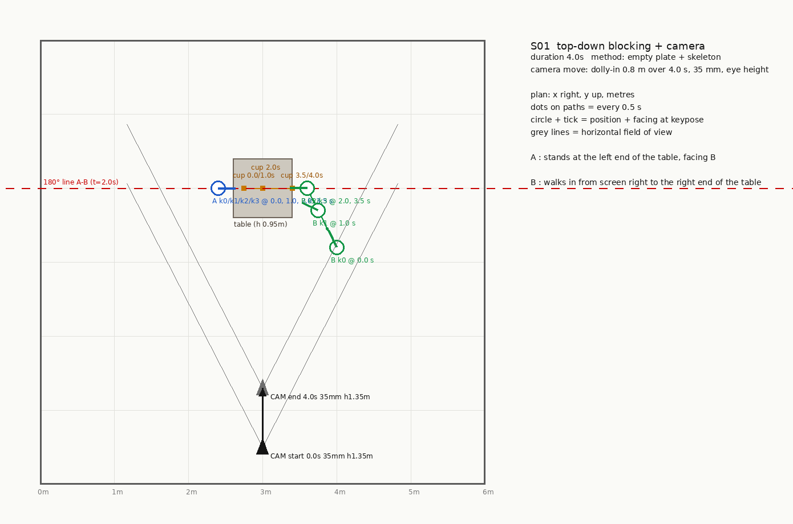
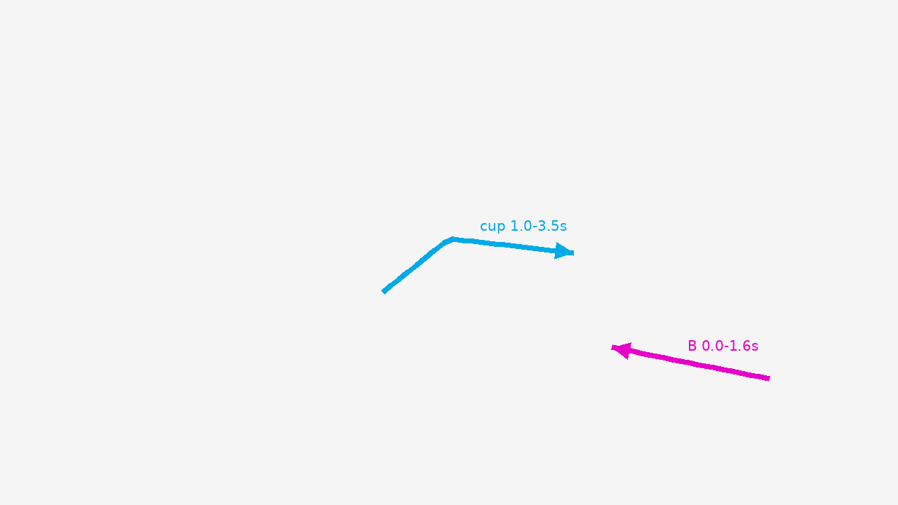
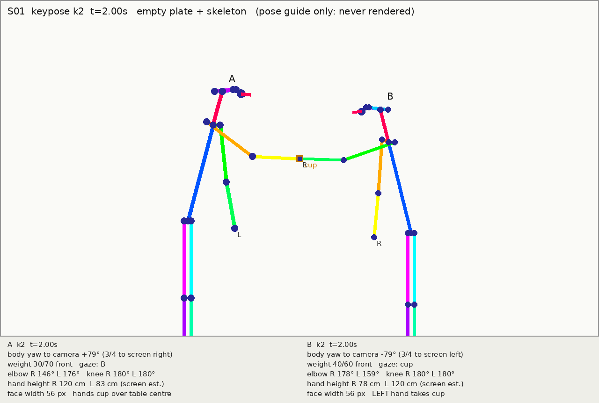
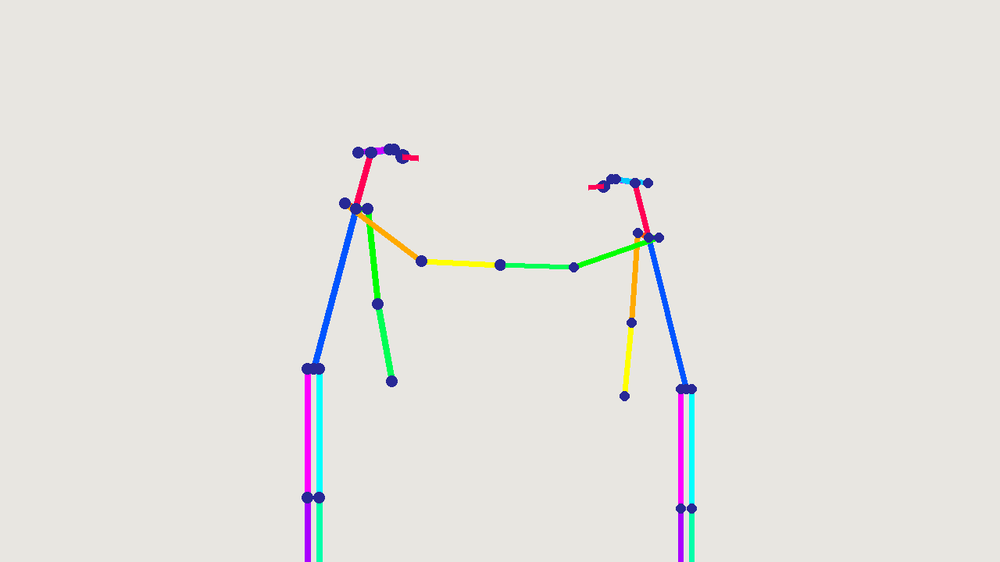

# production_grok: a film-agnostic AI film production team for Grok Bot

> **Built for Grok Bot.** Hand this package to your primary Grok Bot and it sets up a seven-bot film production team for you: install package, 7 bot prompts, skills, SOP, previs tools and knowledge library. Free for anyone who needs it; see each knowledge-library item for its own licence.

**English** · [繁體中文（台灣）](README.zh-TW.md)

Version: install package **v1.3.2**, operating manual **v1.3**, previs builder **1.0**, Film Production Knowledge Library **v1 (package edition 1.3)** · 2026-11-18 (UTC+8) · public repository

---

## 1. What this is

This repository is a complete, reusable **operating system for making AI-generated films with a team of Grok Bots**. It holds:

1. **An install package.** You hand it to your primary Grok Bot and it builds the team: six new bots with their role prompts, five shared skills, one production room, and the Lead role saved to its own memory. It works almost like an installer.
2. **The method.** Five skills say how every production is run: script → references → previs → keyframes → video → QC → edit → audio → delivery → archive. The team standing rules and the owner's review gates are in them too.
3. **The operating manual (v1.3).** The same method in long form, with evidence labels, prompt templates, the QC specification, round and budget rules, and the collaboration protocol. It is reference reading.
4. **A knowledge library.** Nine topics of professional know-how behind the method, with English study notes, a map of which role uses what, and the **full source files**: articles, open-source repos, the owner's research dossiers and cited third-party material.

It is **film-agnostic**. It applies to every kind of production: narrative shorts, series, brand and product films, adverts, music videos, live-action-style films with real people, and films with stylised or licensed characters. It names no project, client or person.

### Why it exists

AI video generators are fast but unreliable. Faces drift, characters stare at the lens, props jump hands, text comes out garbled, and a "small fix" can quietly burn the budget. One bot doing everything tends to approve its own work. The method here grew out of real productions and fixes that in four ways:

- **Separate roles with one owner per task.** The bot that generates a shot never measures it, and the bot that writes the script never renders it.
- **Gates before money and before video.** Nothing is generated before the plan is approved. No video is made, pilot takes included, before the owner has approved the script, the characters, the keyframes and a board showing every shot with its VO and seconds.
- **Measurement instead of opinion.** QC gets numbers (likeness, gaze, design match, motion against the previs guide, loudness), and every number names its metric. Each finding is labelled Verified, Pending, Observed or Hypothesis-untested.
- **Caps that are never extended.** Each shot gets at most 20 minutes and 3 takes. Anything still wrong after that is a documented deviation, not an endless retry loop.

The method was developed and measured with **Grok Imagine** (image and video). Every number in it is an instance from that generator. Check another generator's capabilities before you trust any number.

---

## 2. The team: seven Grok Bots

| # | Role | What it does | Owns | Never does |
|---|---|---|---|---|
| 01 | **Lead (Master)**, your primary bot | Turns the brief into tasks with one owner each and sets the caps. Runs the kickoff with the owner, presents every owner-gate package in one message, records approvals, settles disagreements between roles and keeps the method current. | Task list, `00_docs/KICKOFF_DECISIONS.md`, `00_docs/APPROVALS.md`, round plan, usage stop lines, acceptance notes, escalations | Generating, scripting, drawing previs or measuring when a role owns that work. It never approves money, sharing, delivery or owner gates; the owner does. |
| 02 | **Script & Story** | Upstream authorship: story, script, character, dialogue and subtext, beats, visual and directorial intent, and per-shot intent. It also writes the shot table (facing, camera angle, face shots, exact headcount, prop counts, hand and side) and delivers the OR-1 script package. | Script versions, shot table CSV, must-be-right items, cut-down fallbacks, the story check | Generating, rendering or spending. It never invents citations. |
| 03 | **Casting & Reference** | Owns every reference that defines who or what is on screen. That covers the photo audit, the holdout scoring set, a stepwise choice of identity photo, official designs for stylised or licensed characters, costume and prop references, and character, prop and location sheets. It publishes the reference order and delivers the OR-2 package. | `cast/`, `ref_test/`, `CAST_INDEX.csv` | Generating shots or moving private photos out of the private folder |
| 04 | **Previs & Motion** | Draws motion and camera before generation, so they are not left to text and chance. Per shot it makes a top-down blocking and camera map, an arrow reference, joint-level skeleton keyposes (an annotated version and a clean one), an empty plate, guide coordinates in JSON and the control-prompt wording. It co-builds the OR-4 board. | `previs/` packs and the PROPORTIONS file | Generating final images or video |
| 05 | **Generation & Edit** | Does all image and video generation inside the caps (image prompt first, then the 7-block video prompt), then the edit, post, audio and delivery files. It makes no video before OR-5 and uses no paid API without an OR-6 notice. | `shots/`, `prompts/`, logs, `DEVIATIONS.md`, `edit/`, `export/` | Changing the script or the must-be-right items, or spending beyond the approved plan |
| 06 | **Measurement & QC** | Measures only. Every new keyframe and clip gets a measurement and a one-line PASS or FAIL verdict within 10 minutes. The checks are likeness against a holdout set, gaze and face angle, design match, costume, prop and headcount continuity, motion against the guide, frame checks, and delivery spec and loudness. It also auto-checks every owner-gate package before the owner sees it. | `qc/tools/`, `qc/auto/*.json`, QC report | Generating, or asking anyone to restage a shot just to make a number measurable |
| 07 | **Recorder & Playbook**, reached 1:1 rather than in the room | Records everything: the team architecture, the installed prompts, owner directives verbatim, kickoff records, approvals, FAIL-KEPT records, evidence-labelled findings and the changelog | Playbook, decisions log, approvals log, evidence register, CHANGELOG | Deciding, or ruling between sources |

The production room has six members: the Lead and five production bots. That is the group-chat limit, so the Recorder is messaged 1:1. The full system prompts are in [`roles/`](roles/). Each is under 6,000 characters and starts with the same shared preamble: authority order, kickoff record, QC mode, fixed rules, owner gates, working rules, language, security and generator.

**Authority when sources conflict:** method → skill `ai-film-production-workflow` (standing rules first); scripts → skill `story-and-script-advisory`; division of labour → the role prompts; project choices → the project's `00_docs/KICKOFF_DECISIONS.md`. The manual and the knowledge library are reference reading. Skills and standing rules win on any conflict.

---

## 3. The pipeline: stages S0–S12 and gates G0–G8

| Stage | What happens | Owner | Gate |
|---|---|---|---|
| S0 | Brief intake: one tickable line per instruction; kickoff decisions record | Lead | **G0**: owner confirms the checklist and kickoff record (KD-1 loudness and KD-2 QC mode decided) |
| S1 | Script, beats, shot table, all VO/dialogue with timings | Script & Story | **OR-1**: owner approves the script package before any image work |
| S2 | Plan and budget: cut list, all prompts assembled, models, cost low/expected/high, risks | Lead + Generation & Edit | **G1**: owner approves plan and budget cap. **Nothing is generated or spent before G1.** |
| S3 | Casting and references: photo audit, holdout, identity pick, reference order | Casting & Reference | Photo gate passed, or risk accepted in writing |
| S4 | Character / prop / location sheets | Casting (rendered by Generation within the cap) | **G2 / OR-2**: sheets pass QC; owner approves characters and looks |
| S5 | Previs and motion guides | Previs & Motion | Pack complete; method named; reference order checked |
| S6 | Keyframes: start + middle frames per cut | Generation & Edit | **G3 / OR-3**: owner approves keyframes; **OR-4**: owner approves the pre-video board; **G5**: keyframes pass per QC mode |
| S7 | Video (pilot takes first) | Generation & Edit | **OR-5**: no video before OR-1…OR-4; **G4**: pilot takes + measured usage approved before the batch |
| S8 | Automated QC on every file | Measurement & QC | **G6**: Mode A every shot PASS or locked with deviations; Mode B every gated check PASS or FAIL-KEPT |
| S9 | Edit and post (EDL, comps, cards, subtitles; all text in post) | Generation & Edit | Lead watches the rough cut |
| S10 | Audio: VO, music, SFX, mix, master | Generation & Edit | Loudness (KD-1 target, measured after AAC) and ASR checks pass |
| S11 | Delivery to spec | Generation & Edit → Lead → owner | **G7**: pre-delivery checklist all pass; **G8**: owner accepts |
| S12 | Archive and SOP evidence | Generation & Edit + Recorder + Lead | Archive complete, owner-only |

Details: manual Part 3 ([`reference/AI_FILM_PRODUCTION_MANUAL_v1.3.md`](reference/AI_FILM_PRODUCTION_MANUAL_v1.3.md)) and skill §2.2.

---

## 4. The owner's six review gates (OR-1 to OR-6): mandatory on every production

These are fixed. They are not kickoff options and they apply in both QC modes. The owner (the human producer) approves personally:

1. **OR-1 Script package.** After discussion, the owner sees the full script, the storyboard and shot details (IDs, duration, action, camera, staging, eyelines) and **all VO and dialogue verbatim with timings**. No image work starts before this is approved.
2. **OR-2 Characters and looks.** Character sheets and the costume or look images (定妝) for every character and every look. No keyframe starts before this is approved.
3. **OR-3 Keyframes.** The **start frame and the middle frames of every cut**.
4. **OR-4 Pre-video board.** Before any video is generated, one board shows **every shot's image**, each labelled with its shot ID, start–end seconds, duration and **the exact VO that plays over it**, plus on-screen text and SFX notes. The spec is in [`templates/PRE_VIDEO_BOARD_SPEC.md`](templates/PRE_VIDEO_BOARD_SPEC.md).
5. **OR-5 Video gate.** **No video is generated, pilot takes included, until OR-1 to OR-4 are all approved.** The approvals are recorded in `00_docs/APPROVALS.md` ([template](templates/APPROVALS.md)).
6. **OR-6 Paid API notice.** Before any paid API or paid route is used, the owner is told which service, why and the estimated cost. The team waits for a yes.

Measurement & QC auto-checks every package before the owner sees it. The Lead presents each package in one message and records the answer. The Recorder logs it. A changed item goes back to its gate.

---

## 5. Kickoff decisions: decided per project, never hardcoded

Every project starts with `00_docs/KICKOFF_DECISIONS.md` ([template](templates/KICKOFF_DECISIONS.md)), items KD-1 to KD-15. Each item gets a value, a basis, a confirmer and a date, or it is listed as open with an owner. Nothing carries over from an earlier project. Two items have **no team default**:

- **KD-1 Loudness, by destination.** The value comes from the destination's spec: integrated LUFS ± tolerance and a true-peak ceiling, measured after AAC encoding on every delivered file. Instances from past work: a client presentation at −16 LUFS with TP ≤ −1.5 dBFS, and phone or social-first delivery at about −14 LUFS with TP ≤ −2 dBTP. These are examples, not defaults.
- **KD-2 QC gate authority.**
  - **Mode A (speed):** QC never blocks. At the cap, a shot is locked with deviation lines and production moves on.
  - **Mode B (gate):** a FAIL on a gated check holds that shot at G5 (keyframe → video) or G6 (into the edit). The hold lasts until the check passes or a **FAIL-KEPT** record exists with an ID, a reason and an approver. Mode B also records which checks are gated, who approves FAIL-KEPT and the approver's response time.
  - In both modes, verdicts run in parallel and every deviation is logged.

KD-3 to KD-15 cover the delivery format, runtime and deliverables, likeness and design-match bars, other QC thresholds, the round plan, budget and usage stop lines, the generator and its reference cap, audio, approvers, languages and on-screen text, pilot shots and archiving.

---

## 6. Firm rules: these are not kickoff items

- **Per shot: ≤20 minutes (generation + auto-QC) and ≤3 takes, never extended.** At the cap, lock the take that best meets the must-be-right items and log a deviation.
- Discussion of a failed shot: ≤10 minutes.
- **Natural staging.** Nobody looks into the lens. Faces appear only in designated face shots, which are 3/4, off-lens and head-level. Facing and camera angle come from the shot table.
- **Nothing is generated or spent before the plan is approved (G1), and no video is made before OR-5.**
- All text, logos, subtitles and UI are added in post, never by the generator. Labels never cover faces.
- Each prompt is complete and copy-pasteable, with every fixed string repeated in it. "Same as before" is not allowed.
- Security: never print keys or secrets; send no email or external message unless asked; never change sharing or permissions without asking. Private and work material stay apart, real-person photos stay in the private folder, and third-party IP is respected.
- Cooperation: one owner per task, discussion of concrete artefacts only, one report per finished task, and one-sentence corrections that leave the wrong version visible.

### 6a. Team rulings and one home per rule (new in v1.3)

v1.3 merges what the five specialist bots learned in two real production rounds. Where two roles had written the same rule, it now lives in one place and everyone else cites it:

| Rule | Canonical home |
|---|---|
| Which reference images go into which shot, order, face-free costume crops, style-reference trait check | manual Part 4.2 / 4.9 |
| Content leaks between characters and props (exact headcount, partial bodies, absent characters, prop counts) | previs skill Step 8 and manual 4.12 B-block |
| Prompt wording for face shots, headcount, colours and prop counts | workflow skill §2.3.2 |
| Loudness target vs true-peak ceiling | workflow skill §2.12: keep the ceiling, deliver below the target and report the LU shortfall |

Team rulings (apply to every production):
- A designated face shot whose face cannot be measured is a **QC FAIL (unmeasurable)**, not a silent pass. The fix is the face-shot wording, never turning other shots toward the lens.
- **Measurement & QC owns the usage tally:** it sums every project's generation log and calls the stop about 2 points before the usage stop line.
- **Fix order for a failed take:** trim or crop first (then re-check framing and face visibility), retime at most 1.2×, regenerate last.
- Round 2 never touches round-1 files (MD5 before and after). Path shots use first + last frame, and the end frame must survive any retime.
- Not rules (labelled untested): the "far shoulder, not visible" accessory wording (log a wrong side as a deviation instead) and face-free costume crops as a proven fix. Style references are always checked for gender, age or body traits the script does not state.

---

## 7. How to install the team on another Grok Bot account

1. Get this repository or the install-package zip onto the target account, for example in its Google Drive or as a zip.
2. Open [`START_HERE_EN.md`](START_HERE_EN.md) ([繁中](START_HERE_ZH.md)). It explains the package in plain language.
3. Give [`INSTALL.md`](INSTALL.md) to your **primary Grok Bot** and ask it to run the file. INSTALL is written to the bot and is idempotent. It runs these steps:
   - **Step 0:** open the package and note `<PACKAGE_LOCATION>`.
   - **Step 1:** take stock, with no writes yet.
   - **Step 2:** save the five skills (UpdateSkill).
   - **Step 3:** save the Lead role to memory.
   - **Step 4:** create the six team bots with their role prompts (CreateAgent).
   - **Step 5:** confirm that each bot can load its skills.
   - **Step 6:** create the production room with the Lead and five production bots (CreateChannel, 6 members maximum).
   - **Step 7:** send the kickoff note (SendToAgent).
   - **Step 8:** verify, then report.
4. Start your first project by giving the Lead a brief. It runs G0 with you, including KD-1 and KD-2, before anything else.

What you must do yourself: approve the kickoff record and every OR gate, connect Drive if the package lives there, supply photos and official designs, and approve any spend.

---

## 8. The knowledge library: what the specialist bots know

`knowledge_library/` holds the know-how behind the method. Start at [`knowledge_library/KNOWLEDGE_ROUTER_EN.md`](knowledge_library/KNOWLEDGE_ROUTER_EN.md), which maps problem → topic → original source → role. Every claim in the notes is tagged [Source], [Owner study] or [Ours, untested]. The library is reference reading. Skills and standing rules win on any conflict.

| Topic | What it teaches | Sources included in full |
|---|---|---|
| **T01 Generative video prompting: The Oath** | Grok Imagine's own production walk-through: script → shot list → character sheet (grey 3-view) → locations → keyframes and middle keyframes → the 7-block video prompt (with CRITICAL, Physics and Constraints) → camera in every prompt → picking takes. It also covers 12 techniques, the retry order and verbatim example prompts. | Full text of "Inside Episode 1: The Oath" (Grok Imagine on X), with all its prompts |
| **T02 Post-production vocabulary (100 techniques)** | Naming post and QC techniques precisely instead of saying "make it better": optical flow, motion tracking, stabilisation, pose estimation, matting, relighting, upscaling, automatic detection and so on, with risks and when to use each | The four original images of 東大Codex研究所 (@UT_Codex) "AI動画の映像処理テクニック100選", the post text, the owner's full transcription and analysis (TECH-39) |
| **T03 HyperFrames: HTML to video** | Code-rendered shots for UI, titles, captions, end cards and many aspect or language variants. Covers SPEC numbers before building, story shape for product and launch films, review and snapshot checks, and sound | heygen-com/hyperframes skill files (Apache-2.0, LICENSE kept) and the owner's 11-slide briefing (TECH-35, pptx + text) |
| **T04 Motion direction (huashu-motion)** | Pacing and the energy curve, contrast at section boundaries, sound landing on the frame, point-to-edit feedback, independent verification, and turning experience into rules | alchaincyf/huashu-motion files (MIT, LICENSE kept) and the owner's study (TECH-34) |
| **T05 Code-video family and route selection** | Whether a shot should be generated, coded or hybrid; motion grammar; product-hero motion from measured angles; independent review; heavy 3D on a box with no GPU | The owner's dossiers TECH-10, -12, -15, -17, -22 and -27 |
| **T06 Measured QC and local editing** | Deterministic ffmpeg cuts, loudness, subtitles, reframing, platform templates, the instrument QC menu and honest reporting (measured / looked at / not checked) | The owner's dossier TECH-21 (ffmpeg-skill) |
| **T07 Prompting agents: spec vs loop** | Briefing long agent builds: the spec-grade route (numbers, data-driven, deterministic, staged delivery, failure modes) vs the loop route (patch, don't rewrite) | The owner's dossiers TECH-28 (Art of Prompting) and TECH-14, the latter containing a third-party "創島提示詞" prompt verbatim |
| **T08 Field lessons in the skills** | Pointer: the gates, likeness, motion and physical QC, screens, lip-sync, loudness and delivery lessons that already live in the skills | The skills in `skills/` |
| **T09 Adjacent sources** | Related material: the story role's own library, the owner's storytelling deck, synthetic-advertising and disclosure context | Resemble AI "2026 Synthetic Advertising Report" (CON-0002), full PDF + text |

**Rights and citations.** The owner's rule is that wherever we cite a tech-radar item (TECH-, LIT-, CON-), the actual material is included. A name alone is never enough. The library therefore contains:

- the public sources with their licences;
- the owner's own dossiers in full;
- third-party public works in full as attributed citation. Each has a `CITATION.md` giving the author, the original URL, the retrieval date and a rights note.

A copy grants no licence; each item keeps its own rights. See [`knowledge_library/RIGHTS_AND_CITATIONS.md`](knowledge_library/RIGHTS_AND_CITATIONS.md) and [`knowledge_library/LIBRARY_INDEX.md`](knowledge_library/LIBRARY_INDEX.md), which gives the read status and rights class of every item. A few owner workspace documents hold private project details, so they are listed but not copied.

---

## 8a. Previs tools: draw the skeleton, motion and paths in Python first, then generate (new in v1.3.1)

Generators guess whatever you do not show them: which hand, which way, when, and how big. The Previs & Motion bot therefore writes each shot's blocking as numbers (floor positions, facing, camera keys, prop paths, contact times) and lets [`build_previs.py`](skills/previs-and-motion-guides/tools/build_previs.py) compute the drawings: a top-down blocking and camera map, a screen-direction arrow sheet, joint-level skeleton keyposes (annotated for humans, clean for the generator), grey-box empty plates and the guide coordinates QC measures against. One command rebuilds every pack; built-in checks cover exact headcount, no text in clean images, no people in plates, the guide schema, contacts and arm reach. Python 3 with Pillow and numpy only.

Step-by-step guide, every input field, reference order and QC use: [`tools/README.md`](skills/previs-and-motion-guides/tools/README.md) ([繁中](skills/previs-and-motion-guides/tools/README.zh-TW.md)). Worked demo (invented: A hands a cup across a table to B during a dolly-in): [`tools/example/`](skills/previs-and-motion-guides/tools/example/).

| | |
|---|---|
|  **Top-down map**: positions, 0.5 s path dots, camera start/end with field of view, dolly, 180° line |  **Arrow sheet**: screen direction and timing on a plain background |
|  **Annotated keypose (humans)**: the hand-over at 2.0 s with yaw, elbow angles, hand heights, face width |  **Clean keypose (generator)**: same pose, no text, plain background |
|  **Empty plate, first frame** (grey box, no people) |  **Empty plate, last frame**: same function, after the dolly-in |

Status: demo-tested only (2026-11-18); not yet used on a production take.

---

## 9. Folder map

```text
README.md / README.zh-TW.md      this overview (English / Traditional Chinese)
START_HERE_EN.md / _ZH.md        plain-language entry page for a new user
INSTALL.md                       bootstrap script for the primary Grok Bot
VERSION.md, CHANGELOG.md         versions and change history
roles/01_lead.md … 07_recorder_playbook.md   seven role system prompts (≤ 6,000 characters each)
skills/                          five canonical skills
  ai-film-production-workflow/                 the method; standing rules; §2.0 kickoff; §2.0a owner gates
  ai-film-production-workflow-supplement-1/    real people, crowds, screens, delivery locks
  ai-film-production-workflow-supplement-2/    dialogue films, costume changes, TTS, lip-sync
  story-and-script-advisory/                   script and story procedure
  previs-and-motion-guides/                    previs procedure, guide-coordinate schema, leak prevention
    tools/                                     build_previs.py, example/ demo with outputs, README EN/ZH
templates/                       KICKOFF_DECISIONS, APPROVALS, PRE_VIDEO_BOARD_SPEC, DEVIATIONS,
                                 QC_REPORT_TEMPLATE, PROJECT_FOLDER_LAYOUT, shot_list_header.csv,
                                 gen_count.csv, prompt_log.csv
reference/AI_FILM_PRODUCTION_MANUAL_v1.3.md  operating manual (reference reading, not canonical)
knowledge_library/               README, router, index, rights; T01–T09 topic folders, each with
                                 STUDY_NOTES_EN.md, ROLE_MAP.md and source/
```

---

## 10. Evidence labels

| Label | Meaning |
|---|---|
| **[Verified]** | Measured on more than one shot or test arm, with a raw measurement file behind it |
| **[Pending]** | Measured once or on a small sample. A working default to re-check. |
| **[Observed]** | Seen in outputs but not measured |
| **[Hypothesis-untested]** | A proposal, an external practice or an inference. Use it as an experiment, never as a fact. |

Numbers from earlier productions are *instances, not targets*. Re-validate them on each new generator, model version or tool stack.

---

## 11. Known limits

- **The install has never been run on a second account.** INSTALL.md was written and reviewed, but not yet executed end to end on another Grok Bot account. Expect to fix small things the first time.
- **Some references are unread.** Copying a file is not the same as reading it. LIBRARY_INDEX marks each item FULL, PARTIAL or UNREAD:
  - Several HyperFrames references are unread or partly read, for example storyboard.md and look.md.
  - Several huashu-motion references are unread: director, sound, experience, punch-up and product-demo-continuity.
  - The upstream repos behind the owner's dossiers are unread.
  - The CON-0002 report was copied but not studied.
  - The verbatim third-party prompt in TECH-14 was read by its headings only.
  - The original 100-techniques images were copied; the owner's transcription is what was read in full.
- **The previs builder is demo-tested only.** It ran on the invented demo; it has not been used on a production take, and grey-box plates as generator references are untested.
- **One generator.** The numbers come from Grok Imagine. Other generators need their own capability check.
- **Untested items stay labelled.** For example, cropping costume references faceless and placing accessories on the "far shoulder" are untested or failed. They are logged as QC deviations, not rules.
- **Some cited items are not included.** These are owner-private workspace documents (a guidelines file with project examples, the team sheet, the story role's own library, another assistant's draft) and a storytelling deck that was not located. LIBRARY_INDEX lists them.

---

## 12. What is deliberately not in this repository

There are no API keys, secrets or credentials. There are no videos or audio renders, no real-person photos, and no private, personal or client material. There are no project names. `.gitignore` blocks media, secrets and working folders.
