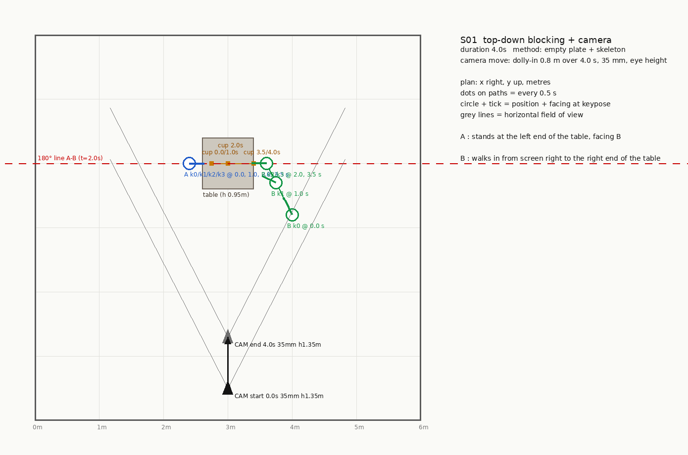
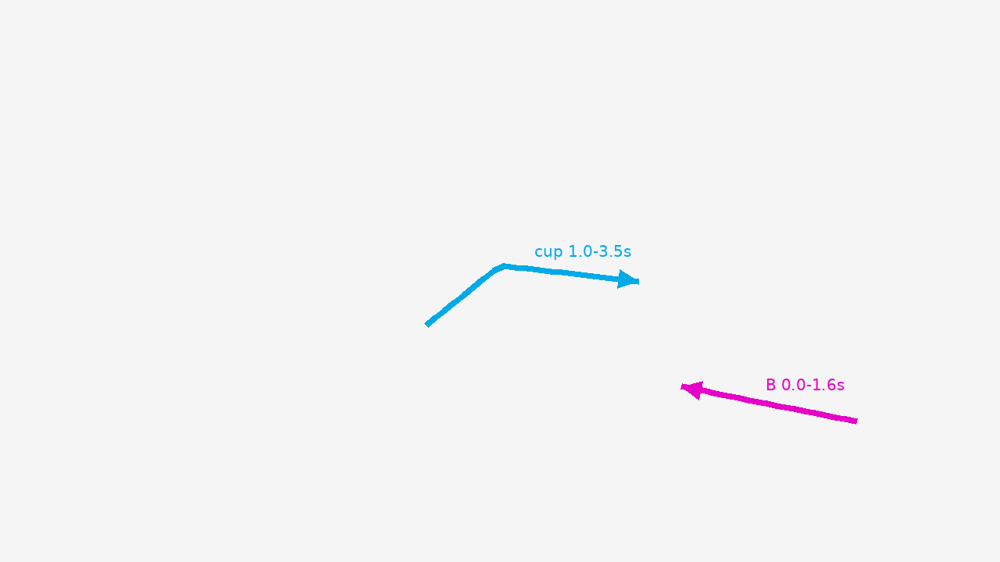
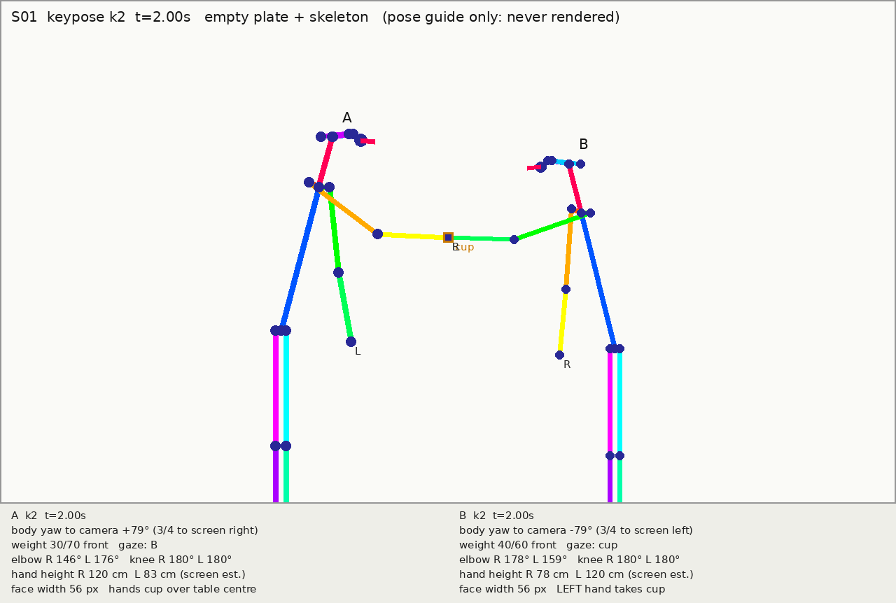
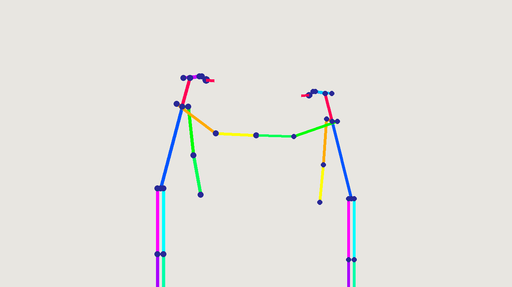

# production_grok：給 Grok Bot 用、不綁定任何一部片的 AI 影片製作團隊

> **專為 Grok Bot 打造。** 把這個安裝包交給你的主要 Grok Bot，它就會幫你建好一支七個 Bot 的影片製作團隊：安裝包、7 個 Bot 的提示詞、Skill、SOP、預演工具和知識庫都在裡面。有需要的人都可以用；知識庫裡每一項資料各有自己的授權，請看各項說明。

[English](README.md) · **繁體中文（台灣）**

版本：安裝包 **v1.3.2**、作業手冊 **v1.3**、預演產生器 **1.0**、影片製作知識庫 **v1（安裝包版 1.3）** · 2026-11-18（UTC+8）· 公開 repo

---

## 1. 這是什麼

這個 repo 是一整套可以重複使用的「**用一群 Grok Bot 製作 AI 影片**」的作業系統，裡面有四樣東西：

1. **安裝包。** 交給你的主要 Grok Bot，它就會建好整支團隊：六個新 Bot（各自有角色提示詞）、五個共用 Skill、一個製作群組，並把 Lead（總監）角色存進它自己的記憶。用起來幾乎就像一個安裝檔。
2. **製作方法。** 五個 Skill 規定每一部片怎麼做：腳本 → 參考圖 → 預演 → 關鍵幀 → 影片 → QC → 剪輯 → 聲音 → 交付 → 歸檔。團隊常設規則和負責人的審核關卡也寫在裡面。
3. **作業手冊（v1.3）。** 同一套方法的長篇版本，附證據標籤、prompt 範本、QC 規格、回合與預算規則，以及協作規範。只當參考讀物。
4. **知識庫。** 九個主題，是這套方法背後的專業知識。每個主題都有英文研究筆記、「哪個角色用哪一段」的對照表，以及**完整的原始檔案**：文章、開源 repo、負責人的研究檔案，還有引用的第三方資料。

整套內容**不綁定任何一部片**，適用於所有製作：敘事短片、影集、品牌與產品片、廣告、MV、真人演出，以及風格化或授權角色的影片。裡面不提任何案名、客戶或個人。

### 為什麼要做這個

AI 影片生成很快，但不可靠：臉會跑掉、角色會盯著鏡頭、道具會換手、文字會亂掉，一個「小修正」就可能悄悄把預算燒光。一個 Bot 包辦所有事，也很容易自己批准自己的作品。這套方法是從實際製作裡長出來的，用四個辦法解決這些問題：

- **角色分工，每件事只有一個負責人。** 生成鏡頭的 Bot 不量自己的鏡頭，寫腳本的 Bot 不負責算圖。
- **花錢和生成影片前都要先過關卡。** 計畫核准前什麼都不生成。負責人看過並核准腳本、角色、關鍵幀，還有一張列出每個鏡頭、VO 和秒數的審片板之前，不做任何影片，試拍也一樣。
- **用量測取代感覺。** QC 給的是數字：像不像本人、視線、設計相似度、動作跟預演軌跡的偏差、響度，而且每個數字都標明用的是哪種量法。每項發現都標上 Verified（已驗證）、Pending（待確認）、Observed（觀察到）或 Hypothesis-untested（假設，未測）。
- **上限不延長。** 每個鏡頭最多 20 分鐘、最多 3 次。超過之後還有問題，就記成偏差，不會一直重試下去。

這套方法是用 **Grok Imagine**（圖像與影片）開發和實測的。裡面的數字都是在這個生成工具上量到的實例，改用其他工具前要先確認它的能力，才能沿用任何數字。

---

## 2. 團隊：七個 Grok Bot

| # | 角色 | 做什麼 | 負責的檔案 | 絕不做 |
|---|---|---|---|---|
| 01 | **Lead（總監）**，就是你的主要 Bot | 把需求拆成任務，每件事只指派一個負責人，並訂上限。跟負責人一起跑開案決定，每道負責人關卡的審核包都整理成一則訊息交給負責人，記錄核准結果，裁決角色之間的分歧，並讓方法跟著實測結果更新。 | 任務清單、`00_docs/KICKOFF_DECISIONS.md`、`00_docs/APPROVALS.md`、回合計畫、用量停損線、驗收紀錄、升級請示 | 有專責角色的工作（生成、寫腳本、畫預演、量測）不自己做；花錢、分享、交付和負責人關卡都由負責人核准，不自己批 |
| 02 | **腳本與故事** | 上游創作：故事、腳本、角色、對白與潛台詞、節拍、視覺與導演意圖，以及每個鏡頭的意圖。也寫分鏡表（看向哪裡、鏡頭角度、露臉鏡頭、確切人數、道具數量、左右手與左右側），並交 OR-1 腳本審核包。 | 腳本各版、分鏡表 CSV、每鏡必須做對的項目、縮短備案、劇情檢查 | 不生成、不算圖、不花錢；不捏造引用來源 |
| 03 | **選角與參考照** | 負責所有決定「畫面裡是誰、是什麼」的參考圖：照片品質檢查、只拿來評分的保留組（holdout）、逐步挑選身分照、風格化或授權角色的官方設計圖、服裝和道具參考圖，以及角色、道具、場景設定圖。發布參考圖順序，並交 OR-2 審核包。 | `cast/`、`ref_test/`、`CAST_INDEX.csv` | 不生成鏡頭；不把私人照片移出私人資料夾 |
| 04 | **預演與動作設計** | 在生成之前先把動作和鏡頭「畫出來」，不留給文字碰運氣。每個鏡頭交俯視走位與攝影機圖、箭頭參考圖、關節層級的骨架關鍵姿勢（標註版和乾淨版）、空景、JSON 格式的軌跡座標，以及控制 prompt 的寫法。也跟生成一起做 OR-4 審片板。 | `previs/` 預演包、比例檔（PROPORTIONS） | 不生成最終圖片或影片 |
| 05 | **生成與剪輯** | 在上限內負責所有圖片和影片生成（先寫圖片 prompt，再寫七段式影片 prompt），之後做剪輯、後製、聲音和交付檔。OR-5 之前不做影片；沒有先發 OR-6 通知就不用付費 API。 | `shots/`、`prompts/`、紀錄檔、`DEVIATIONS.md`、`edit/`、`export/` | 不改腳本或必須做對的項目；不超出核准計畫花錢 |
| 06 | **量測與QC** | 只量測。每張新的關鍵幀、每段新的影片都自動量測，10 分鐘內給一行 PASS 或 FAIL 結論。量的項目有：像不像本人（對照保留組）、視線與臉部角度、設計相似度、服裝道具人數是否連戲、動作與軌跡的偏差、畫面檢查，以及交付規格和響度。負責人看任何審核包之前，都先由它自動檢查。 | `qc/tools/`、`qc/auto/*.json`、QC 報告 | 不生成；不會為了讓數字量得到，就要人重新走位 |
| 07 | **紀錄與手冊**，一對一聯絡，不在群組裡 | 記錄所有事：團隊架構、實際安裝的提示詞、負責人指示的原話、開案紀錄、核准紀錄、FAIL-KEPT 紀錄、附證據標籤的發現，以及變更紀錄 | 手冊（playbook）、決策紀錄、核准紀錄、證據登錄、CHANGELOG | 不做決定，也不在不同來源之間裁決 |

製作群組最多 6 人（Lead 加 5 個製作 Bot），這是群組人數上限，所以紀錄 Bot 用一對一訊息聯絡。完整的系統提示詞在 [`roles/`](roles/)，每份都在 6,000 字元以內，開頭是同一段共用前言：權威順序、開案紀錄、QC 模式、固定規則、負責人關卡、工作方式、語言、安全，以及生成工具。

**資料互相衝突時以誰為準：** 方法 → Skill `ai-film-production-workflow`（常設規則優先）；腳本 → Skill `story-and-script-advisory`；分工 → 角色提示詞；專案選擇 → 該專案的 `00_docs/KICKOFF_DECISIONS.md`。手冊和知識庫都只是參考讀物，跟 Skill 或常設規則衝突時以 Skill 為準。

---

## 3. 製作流程：S0–S12 階段與 G0–G8 關卡

| 階段 | 做什麼 | 負責 | 關卡 |
|---|---|---|---|
| S0 | 收需求：每條指示寫成一行可打勾的清單；開案決定紀錄 | Lead | **G0**：負責人確認清單和開案紀錄（KD-1 響度、KD-2 QC 模式要先定） |
| S1 | 腳本、節拍、分鏡表、所有 VO／對白和秒數 | 腳本與故事 | **OR-1**：負責人核准腳本包之後才開始做圖 |
| S2 | 計畫與預算：鏡頭清單、組好的所有 prompt、模型、費用（低／預期／高）、風險 | Lead＋生成與剪輯 | **G1**：負責人核准計畫和預算上限。**G1 之前不生成、不花錢。** |
| S3 | 選角與參考圖：照片檢查、保留組、挑身分照、參考圖順序 | 選角與參考照 | 照片關卡通過，或書面接受風險 |
| S4 | 角色／道具／場景設定圖 | 選角（在上限內由生成負責算圖） | **G2／OR-2**：設定圖通過 QC，負責人核准角色和定妝 |
| S5 | 預演與動作軌跡 | 預演與動作設計 | 預演包完整、寫明控制方法、參考圖順序已檢查 |
| S6 | 關鍵幀：每個 Cut 的起始圖和中間圖 | 生成與剪輯 | **G3／OR-3**：負責人核准關鍵幀；**OR-4**：負責人核准生成前審片板；**G5**：關鍵幀依 QC 模式通過 |
| S7 | 影片（先做試拍） | 生成與剪輯 | **OR-5**：OR-1 到 OR-4 都核准前不做影片；**G4**：試拍和實際用量核准後才量產 |
| S8 | 每個檔案自動 QC | 量測與QC | **G6**：模式 A 每個鏡頭 PASS，或鎖片並記下偏差；模式 B 每個列管項目 PASS 或有 FAIL-KEPT |
| S9 | 剪輯與後製（EDL、合成、字卡、字幕；所有文字都在後製上） | 生成與剪輯 | Lead 看粗剪 |
| S10 | 聲音：VO、音樂、音效、混音、母帶 | 生成與剪輯 | 響度（KD-1 目標，AAC 編碼後量）和語音辨識檢查通過 |
| S11 | 依規格交付 | 生成與剪輯 → Lead → 負責人 | **G7**：交付前檢查全部通過；**G8**：負責人驗收 |
| S12 | 歸檔與 SOP 證據 | 生成與剪輯＋紀錄＋Lead | 歸檔完成，只有負責人可存取 |

詳細內容見手冊第 3 部（[`reference/AI_FILM_PRODUCTION_MANUAL_v1.3.md`](reference/AI_FILM_PRODUCTION_MANUAL_v1.3.md)）和 Skill §2.2。

---

## 4. 負責人的六道審核關卡（OR-1 到 OR-6）：每部片都必須執行

這六道關卡是固定的，不是開案時可以選的項目，QC 用哪種模式都一樣。由負責人（真人製片）親自核准：

1. **OR-1 腳本包。** 討論完之後交給負責人看：完整腳本、分鏡和鏡頭細節（鏡號、長度、動作、鏡頭、走位、視線），以及**所有 VO 和對白的原文與秒數**。核准之前不開始做圖。
2. **OR-2 角色與定妝。** 每個角色、每套造型的設定圖和定妝圖。核准之前不做關鍵幀。
3. **OR-3 關鍵幀。** **每個 Cut 的起始圖和中間圖。**
4. **OR-4 生成前審片板。** 生成任何影片之前，用一張審片板列出**每個鏡頭的畫面**，每格都標鏡號、起訖秒數、長度，以及**這段畫面上播的 VO 原文**，另外註明畫面文字和音效。規格見 [`templates/PRE_VIDEO_BOARD_SPEC.md`](templates/PRE_VIDEO_BOARD_SPEC.md)。
5. **OR-5 影片關卡。** **OR-1 到 OR-4 全部核准之前，不生成任何影片，試拍也一樣。** 核准結果記在 `00_docs/APPROVALS.md`（[範本](templates/APPROVALS.md)）。
6. **OR-6 付費 API 通知。** 用任何付費 API 或付費管道之前，先告訴負責人用哪個服務、為什麼要用、估計多少錢，等負責人說好才用。

負責人看任何審核包之前，都先由量測與QC 自動檢查；Lead 把審核包整理成一則訊息交給負責人並記錄回覆，紀錄 Bot 再登錄一次。核准之後改過的東西，要回到原本那道關卡重新審。

---

## 5. 開案決定：每個專案各自決定，不寫死

每個專案都從 `00_docs/KICKOFF_DECISIONS.md`（[範本](templates/KICKOFF_DECISIONS.md)）開始，共 KD-1 到 KD-15 項。每一項都要有值、依據、確認人和日期，不然就列成待決並指定負責的人。不沿用上一個專案的決定。其中兩項**沒有團隊預設值**：

- **KD-1 響度，依播放平台決定。** 數值照平台的規格訂：整合響度 LUFS 加容許誤差，以及真峰值上限，每個交付檔都在 AAC 編碼後量。過去的實例：給客戶簡報用 −16 LUFS、真峰值 ≤ −1.5 dBFS；手機或社群優先約 −14 LUFS、真峰值 ≤ −2 dBTP。這些只是例子，不是預設值。
- **KD-2 QC 的把關權限。**
  - **模式 A（速度）：** QC 不擋片。到上限就鎖片並記下偏差，繼續往下做。
  - **模式 B（把關）：** 列管項目 FAIL，那個鏡頭就停在 G5（關鍵幀 → 影片）或 G6（進剪輯），直到通過，或有一筆 **FAIL-KEPT** 紀錄（編號、理由、核准人）為止。模式 B 還要記下哪些項目列管、誰核准 FAIL-KEPT，以及核准人多久內回覆。
  - 兩種模式下，QC 結論都和製作同時進行，每個偏差都要記錄。

KD-3 到 KD-15 涵蓋：交付格式、長度與交付項目、像不像本人和設計相似度的門檻、其他 QC 門檻、回合計畫、預算與用量停損線、生成工具與參考圖上限、聲音、核准人、語言與畫面文字、試拍鏡頭，以及歸檔。

---

## 6. 固定規則：不是開案時決定的項目

- **每個鏡頭：≤20 分鐘（生成＋自動 QC）、≤3 次，不延長。** 到上限就鎖定最符合「必須做對」項目的那一版，並記下偏差。
- 失敗鏡頭的討論：≤10 分鐘。
- **自然走位。** 沒有人看鏡頭。臉只出現在指定的露臉鏡頭，而露臉鏡頭是 3/4 側臉、不看鏡頭、頭擺正。看向哪裡和鏡頭角度一律照分鏡表。
- **計畫核准（G1）前不生成、不花錢；OR-5 之前不做影片。**
- 所有文字、Logo、字幕、介面都在後製加上，不讓生成工具畫字。標籤不蓋到臉。
- 每個 prompt 都是完整、可以直接複製貼上的版本，每段固定設定都要重複寫，不准寫「同上」。
- 安全：絕不印出金鑰或密碼；沒被要求不寄信、不對外發訊息；沒問過不改分享或權限。私人和工作資料分開，真人照片留在私人資料夾，尊重第三方智慧財產權。
- 協作：每件事一個負責人、只討論具體的成品、每件事做完只回報一次；更正用一句話講清楚，並保留錯的版本讓人看得到。

### 6a. 團隊裁定，以及每條規則只放一個地方（v1.3 新增）

v1.3 把五個專業 Bot 在兩輪實際製作學到的東西併進來。以前兩個角色各寫一份的規則，現在只放在一個地方，其他地方都引用它：

| 規則 | 正本位置 |
|---|---|
| 哪張參考圖放進哪個鏡頭、順序、服裝參考圖去臉裁切、風格參考圖的特徵檢查 | 手冊第 4.2／4.9 節 |
| 角色和道具之間的內容外漏（人數寫死、只露局部的角色、不在畫面的角色、道具數量） | 預演 Skill Step 8，以及手冊 4.12 B 區塊 |
| 露臉鏡頭、人數、顏色、道具數量的 prompt 寫法 | 製作流程 Skill §2.3.2 |
| 響度目標和 true peak 上限衝突時 | 製作流程 Skill §2.12：守住上限、響度低於目標交片，並在交片報告寫出差幾 LU |

團隊裁定（每部片都適用）：
- 指定的露臉鏡頭如果量不到臉，就判 **QC FAIL（無法量測）**，不能默默算過。要改的是露臉鏡頭的寫法，絕不是把其他鏡頭轉向鏡頭。
- **用量由量測與 QC 統計：**把每個專案的生成紀錄加總，在用量停止線前約 2 個百分點就喊停。
- **失敗鏡頭的修正順序：**先剪短或裁切（裁完要重查構圖和露臉），再調速最多 1.2 倍，最後才重新生成。
- 第二輪絕不動第一輪的檔案（前後各算一次 MD5）。路徑鏡頭用首幀＋尾幀，調速後最後一幀必須還在。
- 不是規則（標為未驗證）：「在遠側肩膀、看不到」這種配件寫法（配件跑錯邊就記成偏差），以及「服裝參考圖去臉」能確定改善相似度這件事。風格參考圖一律檢查有沒有腳本沒寫的性別、年齡或體型特徵。

---

## 7. 怎麼安裝到另一個 Grok Bot 帳號

1. 把這個 repo 或安裝包 zip 放到目標帳號拿得到的地方，例如它的 Google Drive，或直接給 zip。
2. 打開 [`START_HERE_ZH.md`](START_HERE_ZH.md)（[English](START_HERE_EN.md)），它用白話說明這個安裝包。
3. 把 [`INSTALL.md`](INSTALL.md) 交給你的**主要 Grok Bot**，請它照著執行。INSTALL 是寫給 Bot 看的，重複執行也不會出錯。步驟如下：
   - **Step 0：** 打開安裝包，記下 `<PACKAGE_LOCATION>`。
   - **Step 1：** 盤點現況，先不寫入任何東西。
   - **Step 2：** 存入五個 Skill（UpdateSkill）。
   - **Step 3：** 把 Lead 角色存進記憶。
   - **Step 4：** 建立六個團隊 Bot，並放入各自的角色提示詞（CreateAgent）。
   - **Step 5：** 確認每個 Bot 都載得到自己的 Skill。
   - **Step 6：** 建立製作群組，成員是 Lead 和 5 個製作 Bot（CreateChannel，最多 6 人）。
   - **Step 7：** 發開工通知（SendToAgent）。
   - **Step 8：** 驗證後回報。
4. 第一個專案：把需求交給 Lead。它會先跟你一起跑 G0，包括 KD-1 和 KD-2，才開始做任何事。

你必須自己做的事：核准開案紀錄和每一道 OR 關卡；安裝包放在 Drive 的話要連接 Drive；提供照片和官方設計圖；核准任何花費。

---

## 8. 知識庫：專業 Bot 該有的知識

`knowledge_library/` 收的是這套方法背後的專業知識。從 [`knowledge_library/KNOWLEDGE_ROUTER_EN.md`](knowledge_library/KNOWLEDGE_ROUTER_EN.md) 開始，它的對應是：遇到什麼問題 → 哪個主題 → 哪份原始資料 → 哪個角色。筆記裡每個說法都標了 [Source]（來源原文）、[Owner study]（負責人研究）或 [Ours, untested]（我們的推論，未測）。知識庫只是參考讀物，跟 Skill 或常設規則衝突時以 Skill 為準。

| 主題 | 教什麼 | 完整收錄的來源 |
|---|---|---|
| **T01 生成影片的 prompt 寫法：The Oath（奧德賽）** | Grok Imagine 官方的製作流程：腳本 → 鏡頭清單 → 角色設定圖（灰底三格）→ 場景 → 關鍵幀和中間關鍵幀 → 七段式影片 prompt（包含 CRITICAL、Physics、Constraints）→ 每個 prompt 都寫鏡頭 → 挑選版本。另外整理了 12 個技巧、重試順序和逐字的範例 prompt。 | 〈Inside Episode 1: The Oath〉（Grok Imagine 在 X 上的文章）全文和所有 prompt |
| **T02 後製技法詞彙（100 選）** | 不說「弄好看一點」，而是用技法的名字下指令：光流、動態追蹤、防手震、姿態估計、去背、重打光、放大等等，並寫出各自的風險和適用時機 | 東大Codex研究所（@UT_Codex）〈AI動画の映像処理テクニック100選〉四張原圖和貼文原文、負責人的完整轉錄與分析（TECH-39） |
| **T03 HyperFrames：HTML 轉影片** | 用程式算出的鏡頭（介面、標題、字幕、片尾卡、多種比例和語言版本）：開工前先把形容詞變成數字的 SPEC、產品和發表片的故事結構、審查與快照檢查、聲音 | heygen-com/hyperframes 的 Skill 檔（Apache-2.0，附 LICENSE）、負責人的 11 頁簡報（TECH-35，pptx 加文字版） |
| **T04 動態導演（huashu-motion）** | 節奏和能量曲線、段落交界處要換多種元素製造對比、音效對到畫面落點、指著畫面給回饋、獨立驗證、把經驗變成規則 | alchaincyf/huashu-motion 的檔案（MIT，附 LICENSE）、負責人的研究（TECH-34） |
| **T05 程式影片家族與路線選擇** | 這個鏡頭該用生成、寫程式還是混合；動態文法；從實測角度做產品主視覺動態；獨立審查；在沒有 GPU 的機器上跑重度 3D | 負責人研究檔 TECH-10、-12、-15、-17、-22、-27 |
| **T06 量測式 QC 與本機剪輯** | 可重現的 ffmpeg 剪接、響度、字幕、重新構圖、平台範本、QC 工具清單，以及誠實回報（量過／看過／沒查） | 負責人研究檔 TECH-21（ffmpeg-skill） |
| **T07 對 Agent 下 prompt：規格路線 vs 迴圈路線** | 怎麼交代長時間的 Agent 任務：規格書等級的寫法（數字寫死、資料驅動、結果可重現、分階段交付、先寫失敗模式），對比迴圈路線（局部修補，不重寫） | 負責人研究檔 TECH-28（下 Prompt 的藝術）和 TECH-14，後者逐字收錄了第三方的「創島提示詞」 |
| **T08 已寫進 Skill 的實戰教訓** | 索引：關卡、像不像本人、動作與物理 QC、螢幕、對嘴、響度、交付等教訓，已經寫在各 Skill 裡 | `skills/` 裡的各 Skill |
| **T09 相關資料** | 腳本角色自己的知識庫、負責人的說故事簡報、合成廣告與揭露規範的背景 | Resemble AI〈2026 Synthetic Advertising Report〉（CON-0002）完整 PDF 和文字版 |

**版權與引用。** 負責人的規則是：只要引用到技術雷達的任何一項（TECH-、LIT-、CON-），就要附上實際的資料，不能只留一個名字。所以知識庫收了三類東西：

- 公開資料，附各自的授權；
- 負責人自己的研究檔，完整收錄；
- 第三方的公開作品，以註明出處的引用方式完整收錄。每份都附 `CITATION.md`，寫明作者、原始網址、取得日期和版權說明。

收錄一份副本不代表取得授權，每份資料仍保有各自的權利。詳見 [`knowledge_library/RIGHTS_AND_CITATIONS.md`](knowledge_library/RIGHTS_AND_CITATIONS.md) 和 [`knowledge_library/LIBRARY_INDEX.md`](knowledge_library/LIBRARY_INDEX.md)，後者列出每份資料的閱讀狀態和權利類別。少數負責人的工作文件含有私人專案細節，所以只列出、不收錄。

---

## 8a. 預演工具：先用 Python 畫出骨架、動作和路徑，再生成（v1.3.1 新增）

生成工具會猜所有你沒給它看的東西：哪隻手、往哪走、什麼時候、畫多大。所以預演與動作設計 Bot 先把每個鏡頭的走位寫成數字（地板位置、面向、攝影機 key、道具路徑、接觸時間），再讓 [`build_previs.py`](skills/previs-and-motion-guides/tools/build_previs.py) 算出圖：俯視走位與攝影機圖、畫面方向箭頭圖、關節層級的骨架關鍵姿勢（標註版給人看、乾淨版給生成工具）、灰盒空景，以及 QC 拿來比對的軌跡座標。一行指令重建所有預演包；內建檢查包括確切人數、乾淨版沒有文字、空景沒有人、軌跡格式、接觸和手搆不搆得到。只需要 Python 3、Pillow 和 numpy。

逐步說明、每個輸入欄位、參考圖順序和 QC 用法：[`tools/README.zh-TW.md`](skills/previs-and-motion-guides/tools/README.zh-TW.md)（[English](skills/previs-and-motion-guides/tools/README.md)）。完整示範（虛構：推軌鏡頭中，A 隔著桌子把杯子遞給 B）：[`tools/example/`](skills/previs-and-motion-guides/tools/example/)。

| | |
|---|---|
|  **俯視圖**：位置、每 0.5 秒的路徑點、攝影機起點／終點和視角、推軌、180° 線 |  **箭頭圖**：素色背景上的畫面方向和時間 |
|  **標註版關鍵姿勢（給人看）**：2.0 秒交接瞬間，附身體角度、手肘角度、手的高度、臉寬 |  **乾淨版關鍵姿勢（給生成工具）**：同一個姿勢，沒有文字、素色背景 |
|  **第一格空景**（灰盒，沒有人） |  **最後一格空景**：同一個函式，推軌之後 |

狀態：只在示範上測過（2026-11-18），還沒用在正式拍攝的成片上。

---

## 9. 資料夾地圖

```text
README.md / README.zh-TW.md      本說明（英文／繁體中文）
START_HERE_EN.md / _ZH.md        給新使用者的白話入口頁
INSTALL.md                       給主要 Grok Bot 執行的安裝步驟
VERSION.md、CHANGELOG.md         版本與變更紀錄
roles/01_lead.md … 07_recorder_playbook.md   七個角色的系統提示詞（每份 ≤ 6,000 字元）
skills/                          五個正式 Skill
  ai-film-production-workflow/                 製作方法；常設規則；§2.0 開案決定；§2.0a 負責人關卡
  ai-film-production-workflow-supplement-1/    真人、多人、螢幕畫面、交付鎖定
  ai-film-production-workflow-supplement-2/    對白片、換裝、TTS、對嘴
  story-and-script-advisory/                   腳本與故事作業程序
  previs-and-motion-guides/                    預演作業程序、軌跡座標格式、防止控制圖外洩
    tools/                                     build_previs.py、example/ 示範和產出、中英文說明
templates/                       KICKOFF_DECISIONS、APPROVALS、PRE_VIDEO_BOARD_SPEC、DEVIATIONS、
                                 QC_REPORT_TEMPLATE、PROJECT_FOLDER_LAYOUT、shot_list_header.csv、
                                 gen_count.csv、prompt_log.csv
reference/AI_FILM_PRODUCTION_MANUAL_v1.3.md  作業手冊（參考讀物，不是正式依據）
knowledge_library/               README、索引路由、清單、版權說明；T01–T09 主題資料夾，
                                 每個都有 STUDY_NOTES_EN.md、ROLE_MAP.md 和 source/
```

---

## 10. 證據標籤

| 標籤 | 意思 |
|---|---|
| **[Verified] 已驗證** | 在一個以上的鏡頭或測試組量過，有原始量測檔 |
| **[Pending] 待確認** | 只量過一次或樣本很小，先當工作預設值，要再確認 |
| **[Observed] 觀察到** | 在產出裡看到，但沒量 |
| **[Hypothesis-untested] 假設，未測** | 提案、外部做法或推論。只能當實驗，不能當事實 |

過去製作的數字都只是**實例，不是目標**。換生成工具、模型版本或工具組時都要重新驗證。

---

## 11. 已知限制

- **安裝流程從沒在第二個帳號上跑過。** INSTALL.md 寫好也審過了，但還沒在另一個 Grok Bot 帳號上從頭到尾實際執行過。第一次用時，預期會有些小地方要修。
- **有些參考資料還沒讀。** 收了檔案不等於讀過。LIBRARY_INDEX 每一項都標了 FULL（讀完）、PARTIAL（讀一部分）或 UNREAD（沒讀）：
  - HyperFrames 有幾份參考檔沒讀或只讀一部分，例如 storyboard.md、look.md。
  - huashu-motion 有幾份沒讀：director、sound、experience、punch-up、product-demo-continuity。
  - 負責人研究檔背後的上游 repo 都沒讀。
  - CON-0002 報告收了，但還沒研究。
  - TECH-14 裡那段第三方 prompt 只看過標題。
  - 100 選的四張原圖收進來了，完整讀過的是負責人的轉錄。
- **預演產生器只在示範上測過。** 它跑過虛構示範，還沒用在正式拍攝的成片上；拿灰盒空景當生成參考圖也未測。
- **只用過一種生成工具。** 數字都來自 Grok Imagine，換工具要另外確認能力。
- **沒測過的照樣標示。** 例如服裝參考圖裁成不露臉，還沒測過；配件放在「遠側肩膀」的寫法，試過但失敗。這兩項都記成 QC 偏差，不是規則。
- **有些引用的資料沒有收錄。** 這些是負責人的私人工作文件（含專案實例的指引檔、團隊試算表、腳本角色自己的知識庫、另一個助理的草稿），還有一份沒找到的說故事簡報。LIBRARY_INDEX 有列出來。

---

## 12. 刻意不放進這個 repo 的東西

沒有 API 金鑰、密碼或任何憑證；沒有影片或聲音成品，也沒有真人照片；沒有私人、個人或客戶的資料；沒有任何案名。`.gitignore` 會擋掉媒體檔、機密檔和工作資料夾。
