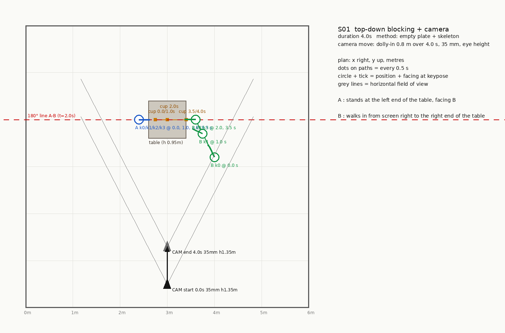
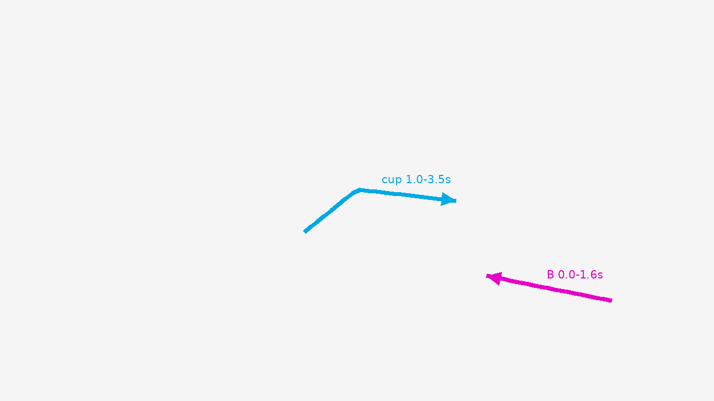
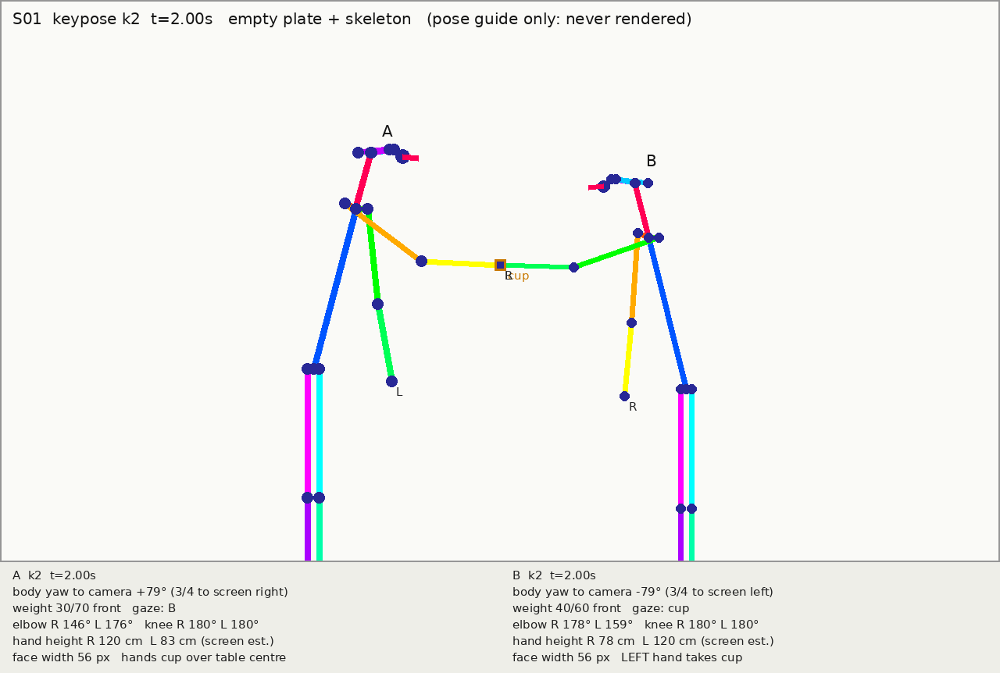
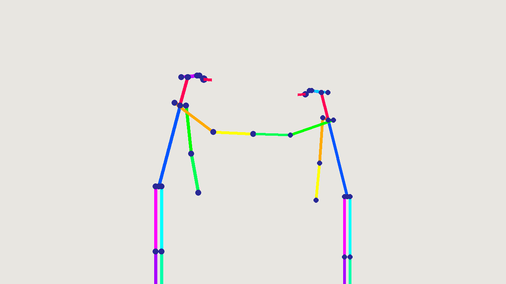
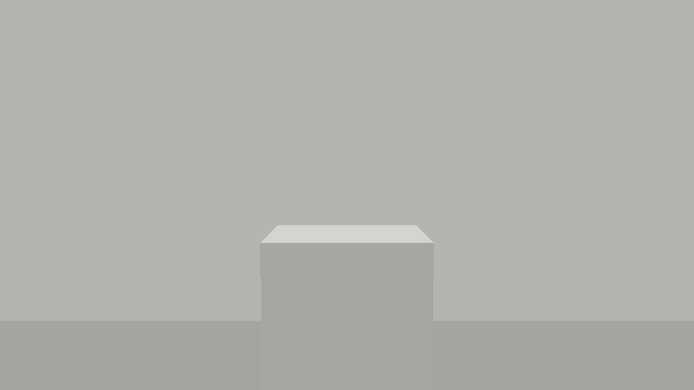
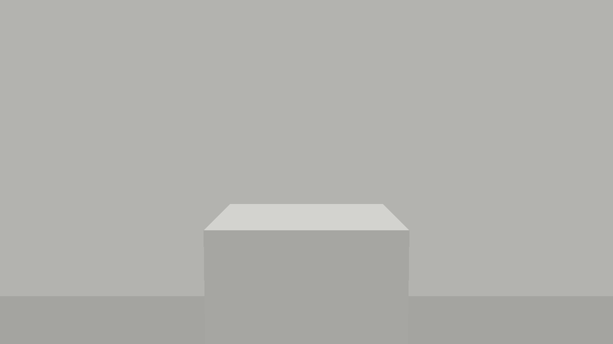

# build_previs.py: draw the skeleton, motion and paths in Python before you generate

**English** · [繁體中文（台灣）](README.zh-TW.md)

> **Built for Grok Bot.** This tool is part of *production_grok*, the film-agnostic AI film production team for Grok Bot. A Grok Bot user hands the install package to their primary Grok Bot, which sets up the seven-bot team; the **Previs & Motion** bot runs this script on its box. You can also run it by hand on any computer with Python 3. The method was developed with Grok Imagine as the generator.

Tool version 1.0 (package v1.3.1, 2026-11-18, UTC+8). Canonical procedure: [`../SKILL.md`](../SKILL.md) (skill `previs-and-motion-guides`). If this README and the skill ever disagree, the skill wins.

---

## 1. What the method is, in one paragraph

A video generator guesses everything you do not show it: which hand picks up the cup, which way a person walks, when the hand-over happens, how big a person is in frame. Words leave path, laterality and timing to chance. So, before any generation, we **write the blocking down as numbers** (where everyone stands on the floor, where the camera is, which way each person faces, where the props move, when contacts happen) and let a script **compute** the drawings from those numbers: a top-down map, a screen-direction arrow sheet, joint-level skeleton keyposes and empty grey-box plates. The same numbers become the guide coordinates that QC later measures the take against. Nothing is drawn by hand, so nothing can be anatomically impossible or disagree with the plan; hand-drawn angles were anatomically impossible once.

## 2. What you get from one command

```bash
python3 build_previs.py --proportions example/proportions.json --shots "example/shot_*.json" --out example/previs
```

| Output | Skill step | Who uses it |
|---|---|---|
| `previs/<SHOT_ID>/INDEX.md` (line 1 `Control method: ...`, file table, pack-check results, warnings) | 2, 10 | Everyone; Lead and QC read the pack check |
| `previs/<SHOT_ID>/topdown.png` (floor plan, trajectories with 0.5 s dots, positions and facing per keypose, camera start/end with field of view, dolly path, 180° line) | 3 | Humans (blocking review, OR-3/OR-4 tiles) |
| `previs/<SHOT_ID>/arrows.png` (screen-direction arrows with timing labels on a plain background) | 4 | Generator only when the shot's method is *first-frame arrows*, as a separate image; otherwise humans |
| `previs/<SHOT_ID>/k<N>_annotated.png` (skeleton plus name, time, body yaw, weight, gaze, elbow/knee angles, hand height, face width, prop markers; notes strip below the frame) | 5 | Humans only |
| `previs/<SHOT_ID>/k<N>_clean.png` (the same skeleton, no text, no props, plain background, frame-sized) | 5 | Generator reference (pose guide) |
| `previs/plates/<SHOT_ID>_first.png`, `_last.png` (grey-box empty plate at t=0 and t=end from one function; no people, no markers) | 6 | Generator reference (layout guide), or a stand-in until a clean rendered plate exists |
| `previs/<SHOT_ID>/<SHOT_ID>_guide_coords.json` (schema exactly as in the skill) | 7 | Measurement & QC |
| `previs/INDEX.md` (all shots, method, pack check, warning count) | 10 | Lead |

Steps the tool does **not** automate: Step 1 measuring proportions on an official image (you type the numbers in), Step 8 the control wording (`prompts/<SHOT_ID>_control.txt`), and Step 9 joins between shots (do it by comparing two shots' `k_last` and `k0` sheets). See section 9.

## 3. Install

Python 3.8 or newer with **Pillow** and **numpy**. Nothing else; no GPU, no 3D software, no network.

```bash
python3 -m pip install pillow numpy
python3 build_previs.py --help
```

Tested on Linux with Python 3 and Pillow 13 / numpy 2.5 (2026-11-18). macOS and Windows are untested: the script falls back to Arial or Pillow's built-in font if DejaVu Sans is missing.

## 4. The worked demo (invented, film-agnostic)

`example/` holds an invented shot, **S01**: two generic adults, **A** (170 cm) and **B** (160 cm), at a standing-height table. B walks in from screen right; A picks up a cup with the right hand at 1.0 s and holds it out over the table; B takes it with the left hand at 2.0 s and holds it at chest height by 3.5 s. The camera dollies in 0.8 m over 4.0 s on a 35 mm lens. Control method: *empty plate + skeleton*. The generated outputs are committed in `example/previs/` so you can look before you run anything.

| | |
|---|---|
|  **topdown.png**: plan in metres; A static at the left end, B's path with 0.5 s dots, the cup's path, camera start (black) and end (grey) with field of view, the dolly arrow and the 180° line between A and B at 2.0 s. |  **arrows.png**: screen-direction arrows only, each with its time range (B 0.0–1.6 s, cup 1.0–3.5 s), in colours that do not occur in the scene. |
|  **k2_annotated.png** (t = 2.0 s, the hand-over): both hands meet the cup; notes give body yaw ±79° (three-quarter, eyelines to each other), elbow angles and hand heights of 120 cm, which match the cup height typed into the shot file. |  **k2_clean.png**: the same pose with no text, no prop marker and a plain background. This is the one that goes to the generator. |
|  **plates/S01_first.png**: grey-box plate at t = 0 (table, floor, walls; no people). |  **plates/S01_last.png**: the same set from the same function at t = 4.0 s, after the dolly-in. |

Colour code in skeletons (OpenPose-like): the character's **right** side is warm (red, orange, yellow, magenta), the **left** side is cool (green, cyan, blue). The short red tick on the head points where the face points. Joints are navy dots. Dashed bones mean a hidden or invisible character (added in post).

## 5. Inputs, field by field

### 5.1 `proportions.json` (Step 1, once per production)

```json
{"reference_character": "A",
 "characters": {"A": {"height_cm": 170, "head_to_body": 7.5, "shoulder_width_ratio": 0.23,
                      "hip_width_ratio": 0.11, "arm_length_ratio": 0.33, "leg_length_ratio": 0.47,
                      "relative_height": 1.0, "label": "estimated", "source": "standard adult proportions"}}}
```

| Field | Required | Meaning | Typical adult |
|---|---|---|---|
| `height_cm` | yes | Standing height. Sets the real-world size used with the camera | script height |
| `head_to_body` | yes | Body height in head heights. Stylised characters keep their official value (often 2–4); do not "correct" them to human proportions | 7–8 |
| `shoulder_width_ratio` | yes | Shoulder joint to shoulder joint / height | 0.22–0.24 |
| `arm_length_ratio` | yes | Shoulder joint to wrist / height | 0.32–0.34 |
| `leg_length_ratio` | yes | Hip joint to ankle / height | 0.46–0.48 |
| `hip_width_ratio` | no (0.11) | Hip joint to hip joint / height | 0.10–0.12 |
| `upper_arm_share`, `thigh_share` | no (0.55, 0.52) | Split of arm and leg between upper and lower segment | |
| `foot_ratio` | no (0.15) | Foot length / height | |
| `face_width_to_head` | no (0.62) | Face width / head height, used to report face width in px | |
| `neck_drop_heads` | no (auto) | Crown to shoulder line, in head heights (auto ≈ 1.3 for 7.5 heads, ≈ 1.1 for 3 heads) | |
| `dashed` | no (false) | Draw the skeleton dashed (hidden or invisible character, effect added in post) | |
| `relative_height`, `label`, `source`, `style_note` | no | Documentation only (Step 1 asks for them): relative height to the reference character, *measured* (joints clicked on an official image) or *estimated*, the source image, style notes | |

Real people: use standard proportions for their age and the script height. **Never measure from identity photos.**

The script derives the segment lengths from these numbers: shoulder line height = 1 − neck drop, hip height = leg + ankle height (0.04), torso = shoulder line − hip height, and so on. If the numbers give a negative torso it stops with an error.

### 5.2 `shot_<ID>.json` (one file per shot; the coordinate master)

Coordinate systems used in the file:

- **Floor plan** in metres: `x` to the right of the plan, `y` up the plan (away from the bottom wall), `z` up from the floor. `facing_deg` is measured counter-clockwise from +x (0 = plan right, 90 = plan up, 180 = plan left, −90 = plan down).
- **Screen** in pixels of the frame (`frame.w` × `frame.h`), origin top-left, y down. Used by `first_frame_px` and `reach_px`.
- **Screen arm angles** in degrees: 0 = straight down, 90 = toward screen right, −90 = toward screen left, 180 = straight up.

Top level:

| Field | Required | Meaning |
|---|---|---|
| `shot_id` | yes | Shot ID from the shot table; output folder name |
| `control_method` | yes | One of `text only`, `first+last frame`, `empty plate + skeleton`, `first-frame arrows`, `segmented extension` (Step 2). Written as INDEX line 1 |
| `frame` | yes | `{"w": 1280, "h": 720}` |
| `duration_s` | yes | Shot length in seconds |
| `headcount` | yes | Exact number of characters in frame (shot table `in_frame`). Checked against the file and against every skeleton sheet |
| `camera` | yes | `move` (text for the map), `sensor_w_mm` (default 36), `keys`: list of `{"t", "pos": [x,y,z], "aim": [x,y,z], "lens_mm"}`. One key = locked-off; two or more = moves (dolly, track, crane, zoom), interpolated linearly |
| `characters` | yes | See below |
| `props` | no | `{"name": {...}}`. `box: [x, y, w, d, h]` (metres, static set piece: drawn on the map and in the plates), optional `z_m` (box base height). `keys: [{"t", "pos": [x,y,z]}]` for a moving prop (drawn on the map and arrows, never in a plate); set `"moving": true` on a moving prop that also has a box |
| `contacts` | no | `[{"t", "who", "hand": "right"/"left", "target"}]`. Copied into the guide JSON and checked: at that time the named wrist must be on the target |
| `room` | no | `{"w_m", "d_m", "h_m"}` for the map grid and plate walls (default 6 × 5 × 2.8) |
| `axis_180` | no | `{"between": ["A", "B"], "t": 2.0}` draws the 180° line through two characters' positions at time t |
| `action` | no | One sentence, copied to INDEX |
| `arrow_colours` | no | List of RGB triples; pick colours that do not occur in the scene |
| `reverses` | no | List of notes printed in red on the map (deliberate screen-direction reverses) |

Each character:

| Field | Required | Meaning |
|---|---|---|
| `proportions` | no (= name) | Key in `proportions.json` |
| `in_frame` | no (true) | False = not drawn and not counted (the character exists only for the plan) |
| `anchor` | no (`hip`) | `hip`, `head` or `feet`: which point the guide track follows |
| `first_frame_px` | no | `[x, y]` hip position you expect in the first frame (for example read off a storyboard). Checked against the projection of the floor position; FAIL if more than 3 % of frame width away |
| `waypoints` | yes | `[{"t", "floor": [x, y], "facing_deg"}]`, at least one. Positions and facing are interpolated between waypoints (facing along the shorter turn) and held after the last one |
| `keyposes` | yes for a skeleton | List of keyposes, below. Keyposes with the same `id` across characters form one sheet (`k0`, `k1`, …) |
| `note` | no | One line for the map legend |

Each keypose:

| Field | Meaning |
|---|---|
| `id`, `t` | Sheet name and time (s) |
| `stance` | `stand` (default), `walk` (stride from `stride_deg`, default 18) or `sit` (hip at `seat_height_m`, default 0.45) |
| `torso_lean_deg` | Lean of the torso on screen; + = top toward screen right |
| `head_tilt_deg`, `head_yaw_deg` | Head tilt on screen; head turn relative to the body (+ = toward screen right) |
| `r_arm`, `l_arm` | Either `{"upper": deg, "fore": deg}` (screen angles of upper arm and forearm; optional `foreshorten` 0–1 for an arm pointing at or away from the lens), or `{"reach": "<prop>", "elbow": "down"/"up"}` (two-bone IK: the wrist goes to the prop's screen position at that time), or `{"reach_px": [x, y], "elbow": ...}` |
| `r_leg`, `l_leg` | Optional override `{"thigh": deg, "shin": deg}` |
| `facing`, `weight`, `gaze`, `note` | Free text printed on the annotated sheet (Step 5 asks for body facing, weight split and gaze) |

Body yaw to the camera is **computed**, not typed: from the character's floor facing and the direction to the camera at that time (0° = facing the lens, ±90° = profile, 180° = back to camera). Character's right is screen-left when facing the lens; the script handles the mirror for you.

## 6. How the numbers become pictures

1. **Camera.** At time t the camera key gives position, aim and lens. Focal length in pixels = lens_mm / sensor_w_mm × frame width. A floor point is projected with a pinhole model.
2. **Where the person stands and how big.** The hip point (floor position at hip height, or seat height + 0.04 m when seated) is projected to the screen. Pixels per body height = focal_px × height_m / depth. So a skeleton is automatically the size the lens would make it; the annotated sheet prints the resulting **face width in px**. Compare it with the shot size you want (manual §3.7 item 13: at 1280×720 medium ≈ 170 px, medium close ≈ 230 px, close ≈ 300 px) and move the camera or change the lens if it is wrong; a too-small skeleton once produced a wide shot.
3. **Joints.** Torso, neck and head from the hip with the lean; shoulder and hip width scaled by |cos(yaw)| (profile = narrow); arms by screen angles or IK to a target; legs by stance; feet point the way the body faces. Elbow and knee angles and hand heights are measured back off the drawn joints and printed, so you can see that the pose is possible.
4. **Reach check.** If a hand cannot reach its target with the arm length from the proportions file, a warning says by how many pixels. In the demo this caught an impossible first layout (cup too far from A); the fix was to move people and props, not to stretch arms.
5. **Plates.** Floor, walls and every static box are projected, back faces culled, clipped at the near plane, and filled with flat shaded greys (room surfaces first, then props far to near). First and last plates come from the same function, so set dressing cannot differ; only the camera moves.
6. **Guide coordinates.** Track times are every 0.5 s from 0 to the end, plus every waypoint and contact time. Each person's anchor and each moving prop is projected through the camera at that time and written as percent of the frame.

## 7. How the images are used as generation references

Follow the canonical rules; do not invent an order. **Reference order** (workflow skill, likeness section): identity → costume/prop of the on-screen wearer → official design + sheet of each stylised character → **empty plate** → **skeleton**. Control images always come last.

| Image | To the generator? | Notes |
|---|---|---|
| `k<N>_clean.png` | **Yes** (method *empty plate + skeleton*, and the start/middle/end frames of *first+last frame*) | Pose guide. Say in the prompt: "Pose like the skeleton reference but draw NOTHING from it: no lines, dots or coloured strokes." |
| `plates/<SHOT>_first.png` / `_last.png` | **Yes**, as the layout guide, unless you have a clean rendered plate (then use that) | Never merged with the skeleton: plate and skeleton are two separate images (manual §3.7 item 10). Same plate family for first and last frame (item 11). Say: "render every block as a real 3D {material} object; NO flat colour patches." |
| `arrows.png` | **Only** when the shot's method is *first-frame arrows*, as a separate reference | Arrows overlaid on a first frame are generated too and stay about 0.25 s; trim ≥ 0.3 s at the head if you overlay (item 9). Say: "The arrows are motion instructions only; never render them." |
| `k<N>_annotated.png` | **No** | Humans only: owner review (OR-3/OR-4 tiles), team discussion |
| `topdown.png` | **No** (it has text) | Humans only. The *clean path map* test arm needs a text-free map, which this tool does not produce yet |

Typical use for the demo method (*empty plate + skeleton*): generate the first frame from identity → costume → `plates/S01_first.png` → `k0_clean.png`; generate the key end frame from the same references with `plates/S01_last.png` → `k3_clean.png`; the OR-3 owner gate reviews start and middle frames (use `k2` for the middle). No video before OR-1 to OR-4 are approved (OR-5). Copy the leak-prevention lines from the skill section "Control-image leak prevention" and the content-leak lines from Step 8 into the control wording.

## 8. How QC uses `<SHOT_ID>_guide_coords.json`

Schema (identical to the skill):

```json
{"shot": "S01", "frame_w": 1280, "frame_h": 720,
 "people": {"A": {"anchor": "hip", "track": [{"t": 0.0, "x_pct": 33.44, "y_pct": 63.87}, ...]}},
 "props":  {"cup": {"track": [{"t": 0.0, "x_pct": 43.08, "y_pct": 57.37}, ...]}},
 "contacts": [{"t": 2.0, "who": "B", "hand": "left", "target": "cup"}]}
```

`x_pct`/`y_pct` are percent of frame width/height **as seen at time t**. With a locked-off camera that equals first-frame coordinates; with a moving camera the builder projects through the camera path, so the dolly-in's growth toward the frame edges is already in the track.

Measurement & QC (manual §3.10 item 5, §5.7), per 0.5 s: measure the same anchor on the take (for example the hip midpoint from a pose estimator), compute the deviation in px against the guide, the timing offset of each contact in seconds, which hand made the contact (FAIL on the wrong hand or a missed contact), guide lines leaked into the frame (must be 0) and position jumps across joins. Minimal comparison sketch (the measured file is whatever your tracker writes, same schema):

```python
import json, math
g = json.load(open("S01_guide_coords.json")); m = json.load(open("S01_take1_measured.json"))
W, H = g["frame_w"], g["frame_h"]
for name, p in g["people"].items():
    meas = {round(q["t"], 2): q for q in m["people"][name]["track"]}
    for q in p["track"]:
        r = meas.get(round(q["t"], 2))
        if r:
            dx, dy = (r["x_pct"] - q["x_pct"]) / 100 * W, (r["y_pct"] - q["y_pct"]) / 100 * H
            print(name, q["t"], "deviation px", round(math.hypot(dx, dy), 1))
```

This sketch was run only against the guide file itself (deviation 0); it has not been run on a real take.

## 9. Pack check (Step 10) and the exit code

Every build prints, per shot, and writes into INDEX.md:

- **Exact headcount**: the number of in-frame characters equals `headcount`, and every keypose sheet has exactly that many skeletons.
- **Clean images contain no text**: two guards. While drawing, the clean canvas refuses any text call. After saving, every pixel must be a background, joint or bone colour; text is drawn in dark grey, which is not in that palette, so any text pixel fails.
- **Plates contain no person or marker colour**: every plate pixel must be neutral grey (no saturated pixel).
- **Guide JSON matches the skill schema**: exact top-level keys, anchor in head/hip/feet, each track spans 0 to the end with no gap over 0.5 s, contact hands are left/right.
- **Contacts**: the named wrist is within 4 % of body height of the target at the contact time (needs a keypose at that time).
- **first_frame_px** (if given): within 3 % of frame width of the projection.
- Control method line on INDEX line 1; plate and skeleton never merged.

Warnings (not failures): a hand that cannot reach its target, an arrow crossing a face at k0, a character behind the camera. The script exits 0 when every shot passes and 1 otherwise, so you can use it in a pipeline. One command (`--shots "shot_*.json"`) rebuilds every pack from the coordinate master; never edit the PNGs by hand.

## 10. Step-by-step for a first-time user

1. Copy `example/` to your project's `previs/` folder.
2. Fill `proportions.json` from the cast index (Step 1). Stylised characters: their official head-to-body ratio.
3. For each shot-table row, copy `shot_S01.json` to `shot_<ID>.json` and fill it: method, duration, headcount, camera, set pieces, each character's floor waypoints and facing (follow the shot table `facing` and `cam_angle`; natural staging: eyeline to a partner, task or destination; frontal faces only on `face_shot = yes` rows), the moving props, keyposes at the times that matter (start, contact, end), contacts.
4. Run the command. Read the console: fix every FAIL and every reach warning by changing the numbers.
5. Open `topdown.png` and `k*_annotated.png`. Check face width against the shot size, hands and sides against the shot table, eyelines and the 180° line. Change numbers, run again.
6. Hand `k*_clean.png`, the plates and the guide JSON to Generation & Edit and Measurement & QC; put the annotated sheets on the OR-3/OR-4 tiles.
7. Write `prompts/<SHOT_ID>_control.txt` by hand (Step 8) and check joins (Step 9).
8. Log actual minutes; the pack proposal is ≤ 15 minutes per shot.

## 11. Limits (read before relying on it)

- **Demo only so far.** The tool was built and run on the invented demo and on a stylised seated test on 2026-11-18. It has **not been used on a production take**; whether its clean skeletons and grey-box plates improve Grok Imagine output compared with the earlier project-specific scripts is **untested**.
- **2D skeleton.** Joints are placed in screen space with one scale per person; limbs pointing at or away from the lens need `foreshorten` by hand. No fingers, no face landmarks beyond eyes, ears and nose. Profile shoulders overlap.
- **Grey-box plates only.** Boxes, floor and walls. A clean rendered or generated plate (Step 6) is better for final references; grey-box plates as generator references are untested.
- **Moving-camera tracks** (screen position at time t) have not been compared with a measured take yet. **[untested]**
- **Not automated:** Step 8 control wording, Step 9 joins, the text-free *clean path map* test arm, segmented extension.
- **Arrow-over-face check** looks at faces at the first keypose only.
- **Fonts and platforms:** Linux tested; macOS/Windows untested.
- Gray-box previs **clips** (video) and video-to-video re-rendering are outside this tool and untested (skill).
