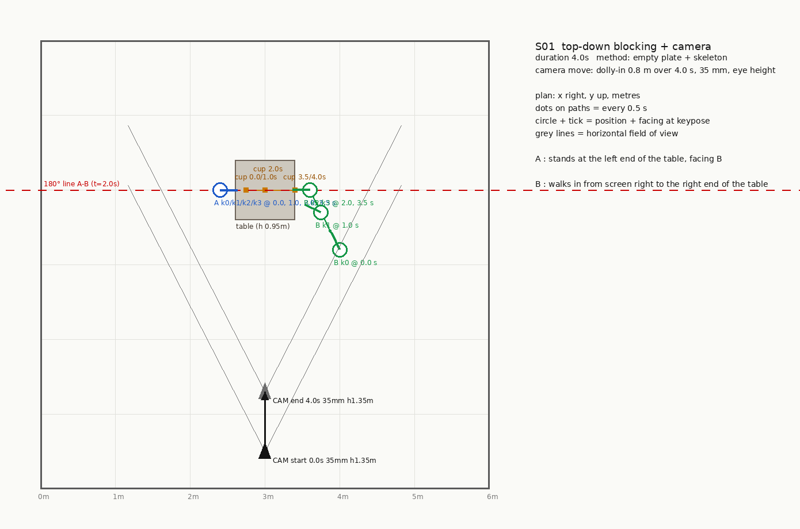
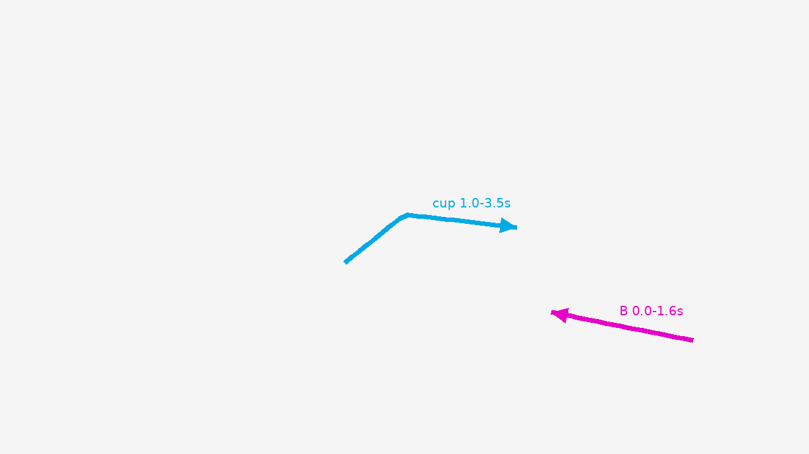
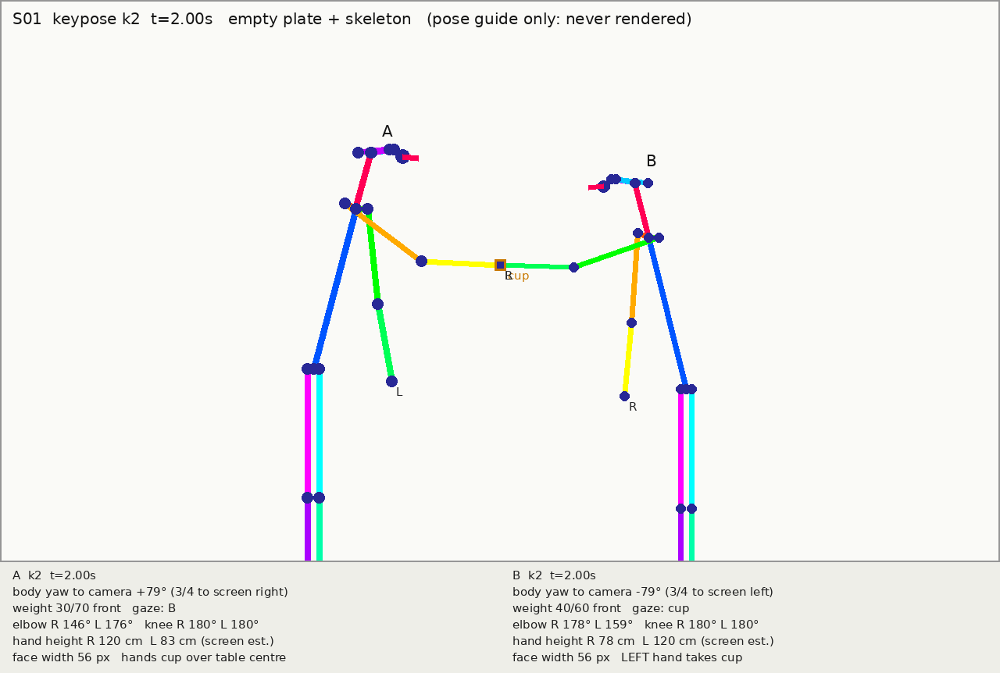
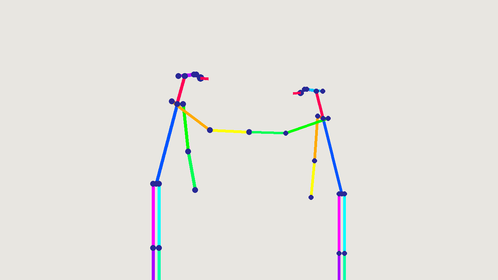
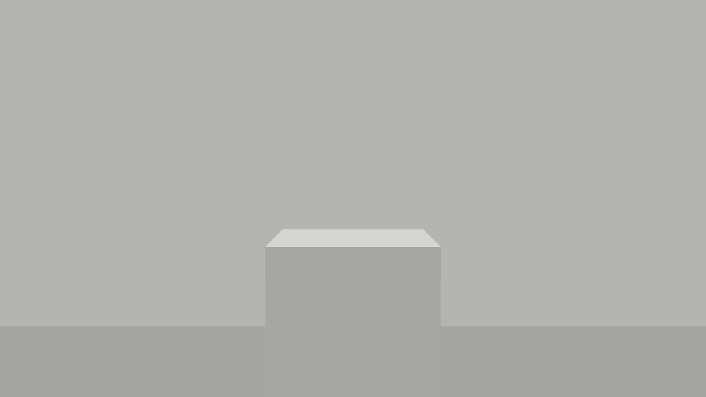
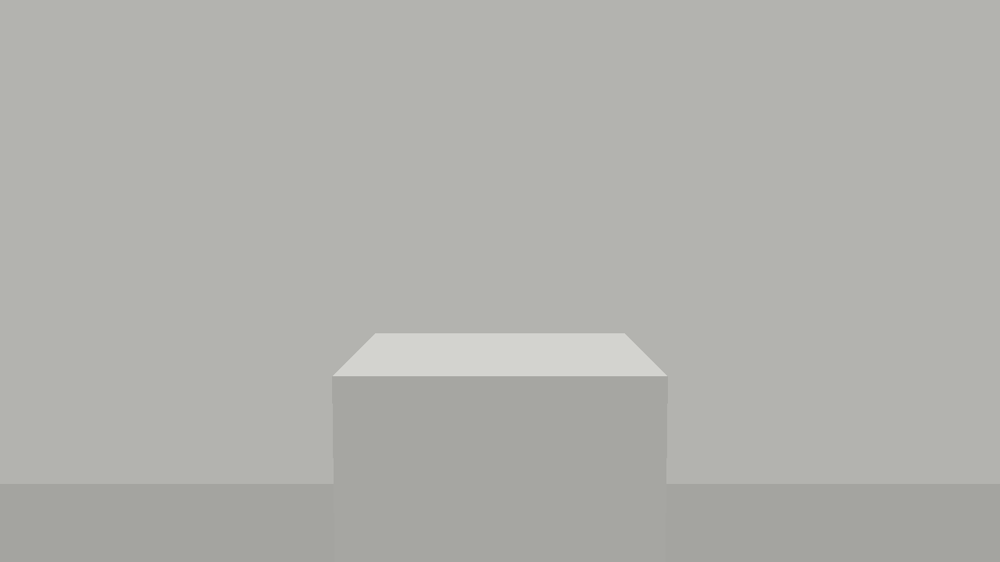

# build_previs.py：先用 Python 畫出骨架、動作和路徑，再生成

[English](README.md) · **繁體中文（台灣）**

> **專為 Grok Bot 打造。** 這支工具屬於 *production_grok*：一套給 Grok Bot 用、不綁定任何一部片的 AI 影片製作團隊。Grok Bot 使用者把安裝包交給自己的主要 Grok Bot，主要 Bot 就會建好七個 Bot 的團隊；其中的**預演與動作設計** Bot 會在它的電腦上跑這支程式。你也可以在任何裝了 Python 3 的電腦上自己跑。這套方法是用 Grok Imagine 當生成工具開發出來的。

工具版本 1.0（安裝包 v1.3.1，2026-11-18，UTC+8）。正式作業程序以 [`../SKILL.md`](../SKILL.md)（skill `previs-and-motion-guides`）為準；本說明和 skill 不一致時，以 skill 為準。

---

## 1. 這個做法是什麼（一段話）

影片生成工具會「猜」所有你沒給它看的東西：哪隻手拿杯子、人往哪邊走、什麼時候交接、人在畫面裡多大。只用文字，路徑、左右手和時間點都靠運氣。所以在生成之前，我們先把走位**寫成數字**：每個人站在地板的哪裡、攝影機在哪、每個人面向哪、道具怎麼移動、什麼時候接觸。然後讓程式**從這些數字算出**圖：俯視圖、畫面方向箭頭圖、關節層級的骨架關鍵姿勢、灰盒空景。同一份數字也會變成軌跡座標，QC 之後拿它來量成片。全部不靠手畫，所以不會畫出人體做不到的姿勢，也不會跟計畫對不上。以前手畫的角度就曾經畫出人體做不到的姿勢。

## 2. 一行指令產出什麼

```bash
python3 build_previs.py --proportions example/proportions.json --shots "example/shot_*.json" --out example/previs
```

| 輸出 | 對應 skill 步驟 | 給誰用 |
|---|---|---|
| `previs/<SHOT_ID>/INDEX.md`（第 1 行 `Control method: ...`、檔案表、檢查結果、警告） | 2、10 | 所有人；Lead 和 QC 看檢查結果 |
| `previs/<SHOT_ID>/topdown.png`（平面圖、每 0.5 秒一點的移動軌跡、每個關鍵姿勢的位置和面向、攝影機起點／終點和視角、推軌路徑、180° 線） | 3 | 人看（走位審查、OR-3／OR-4 審片格） |
| `previs/<SHOT_ID>/arrows.png`（素色背景上的畫面方向箭頭，標時間） | 4 | 只有當這個鏡頭的控制法是「first-frame arrows」時才給生成工具，而且是獨立一張；其他情況只給人看 |
| `previs/<SHOT_ID>/k<N>_annotated.png`（骨架加上名字、時間、身體角度、重心、視線、手肘／膝蓋角度、手的高度、臉寬、道具位置；註解放在畫面下方的說明條） | 5 | 只給人看 |
| `previs/<SHOT_ID>/k<N>_clean.png`（同一副骨架，沒有文字、沒有道具、素色背景、跟畫面同尺寸） | 5 | 給生成工具當參考圖（姿勢參考） |
| `previs/plates/<SHOT_ID>_first.png`、`_last.png`（同一個函式畫出 t=0 和最後一秒的灰盒空景，沒有人、沒有色塊標記） | 6 | 給生成工具當構圖參考；有乾淨的算圖空景之前先拿它代替 |
| `previs/<SHOT_ID>/<SHOT_ID>_guide_coords.json`（格式和 skill 完全一致） | 7 | 量測與 QC |
| `previs/INDEX.md`（所有鏡頭、控制法、檢查結果、警告數） | 10 | Lead |

工具**不會**自動做的步驟：步驟 1 在官方設計圖上量比例（數字要你自己填）、步驟 8 寫控制 prompt（`prompts/<SHOT_ID>_control.txt`）、步驟 9 鏡頭之間的銜接（拿前一鏡的最後姿勢和下一鏡的 `k0` 對照）。見第 9 節。

## 3. 安裝

Python 3.8 以上，加上 **Pillow** 和 **numpy**。其他都不用：不用 GPU、不用 3D 軟體、不用連網。

```bash
python3 -m pip install pillow numpy
python3 build_previs.py --help
```

已在 Linux（Python 3、Pillow 13、numpy 2.5，2026-11-18）上測過。macOS 和 Windows 還沒測：找不到 DejaVu Sans 字型時，程式會改用 Arial 或 Pillow 內建字型。

## 4. 完整示範（虛構，不屬於任何一部片）

`example/` 裡是一個虛構鏡頭 **S01**：兩個一般成人 **A**（170 cm）和 **B**（160 cm），站在一張站立高度的桌子兩端。B 從畫面右邊走進來；A 在 1.0 秒用右手拿起杯子，舉到桌子上方遞出去；B 在 2.0 秒用左手接過，3.5 秒時拿在胸口高度。攝影機用 35 mm 鏡頭，4.0 秒內往前推軌 0.8 公尺。控制法：「empty plate + skeleton」（空景加骨架）。產出的圖都已經放在 `example/previs/`，不用先跑就能看。

| | |
|---|---|
|  **topdown.png**：以公尺為單位的平面圖。A 站在左端不動；B 的路徑每 0.5 秒一點；杯子的路徑；攝影機起點（黑）和終點（灰）和視角；推軌箭頭；2.0 秒時 A、B 之間的 180° 線。 |  **arrows.png**：只有畫面方向箭頭，各標時間範圍（B 0.0–1.6 秒、杯子 1.0–3.5 秒），顏色選場景裡不會出現的顏色。 |
|  **k2_annotated.png**（t = 2.0 秒，交接瞬間）：兩隻手都碰到杯子。註解寫出身體角度 ±79°（四分之三側面，兩人互看）、手肘角度，以及兩人的手都在 120 cm 高，跟鏡頭檔裡填的杯子高度一致。 |  **k2_clean.png**：同一個姿勢，沒有文字、沒有道具標記、素色背景。給生成工具的是這一張。 |
|  **plates/S01_first.png**：t = 0 的灰盒空景（桌子、地板、牆，沒有人）。 |  **plates/S01_last.png**：同一個場景、同一個函式，t = 4.0 秒推軌之後的畫面。 |

骨架的顏色（類似 OpenPose）：角色的**右邊**是暖色（紅、橘、黃、洋紅），**左邊**是冷色（綠、青、藍）。頭上的紅色短線指向臉朝的方向。關節是深藍色圓點。虛線骨架代表隱形或看不見、後製才加上的角色。

## 5. 輸入檔，逐欄說明

### 5.1 `proportions.json`（步驟 1，每部片做一次）

```json
{"reference_character": "A",
 "characters": {"A": {"height_cm": 170, "head_to_body": 7.5, "shoulder_width_ratio": 0.23,
                      "hip_width_ratio": 0.11, "arm_length_ratio": 0.33, "leg_length_ratio": 0.47,
                      "relative_height": 1.0, "label": "estimated", "source": "standard adult proportions"}}}
```

| 欄位 | 必填 | 意思 | 一般成人 |
|---|---|---|---|
| `height_cm` | 是 | 站立身高，搭配攝影機決定人在畫面裡的實際大小 | 腳本設定身高 |
| `head_to_body` | 是 | 頭身比（身高等於幾個頭高）。風格化角色照官方設定（常是 2–4 頭身），不要「修正」成真人比例 | 7–8 |
| `shoulder_width_ratio` | 是 | 兩肩關節距離 ÷ 身高 | 0.22–0.24 |
| `arm_length_ratio` | 是 | 肩關節到手腕 ÷ 身高 | 0.32–0.34 |
| `leg_length_ratio` | 是 | 髖關節到腳踝 ÷ 身高 | 0.46–0.48 |
| `hip_width_ratio` | 否（0.11） | 兩髖關節距離 ÷ 身高 | 0.10–0.12 |
| `upper_arm_share`、`thigh_share` | 否（0.55、0.52） | 上臂佔整隻手臂、大腿佔整條腿的比例 | |
| `foot_ratio` | 否（0.15） | 腳長 ÷ 身高 | |
| `face_width_to_head` | 否（0.62） | 臉寬 ÷ 頭高，用來回報臉寬幾 px | |
| `neck_drop_heads` | 否（自動） | 頭頂到肩線有幾個頭高（自動：7.5 頭身約 1.3，3 頭身約 1.1） | |
| `dashed` | 否（false） | 骨架畫成虛線（隱形角色，後製加效果） | |
| `relative_height`、`label`、`source`、`style_note` | 否 | 只當紀錄（步驟 1 要求寫）：相對參考角色的身高、*measured*（在官方圖上點關節量的）或 *estimated*（估的）、來源圖、風格說明 | |

真人：用該年齡和腳本身高的標準比例。**絕對不要從本人照片量。**

程式從這些數字推出每一節的長度：肩線高度 = 1 − 頭頂到肩線、髖部高度 = 腿長 + 腳踝高（0.04）、軀幹 = 肩線 − 髖部，以此類推。數字算出負的軀幹長度時，程式會報錯停下來。

### 5.2 `shot_<ID>.json`（每個鏡頭一個檔；座標的總表）

檔案裡用到的座標系：

- **地板平面**，單位公尺：`x` 往平面圖右邊、`y` 往平面圖上方（離開下方那面牆）、`z` 從地板往上。`facing_deg` 從 +x 逆時針量（0 = 平面圖右、90 = 上、180 = 左、−90 = 下）。
- **畫面**，單位是畫面像素（`frame.w` × `frame.h`），原點在左上，y 往下。用在 `first_frame_px` 和 `reach_px`。
- **手臂的畫面角度**，單位度：0 = 正下方、90 = 往畫面右、−90 = 往畫面左、180 = 正上方。

最上層欄位：

| 欄位 | 必填 | 意思 |
|---|---|---|
| `shot_id` | 是 | 分鏡表上的鏡號，也是輸出資料夾名稱 |
| `control_method` | 是 | 五選一：`text only`、`first+last frame`、`empty plate + skeleton`、`first-frame arrows`、`segmented extension`（步驟 2）。會寫在 INDEX 第 1 行 |
| `frame` | 是 | `{"w": 1280, "h": 720}` |
| `duration_s` | 是 | 鏡頭長度（秒） |
| `headcount` | 是 | 畫面裡的確切人數（分鏡表的 `in_frame`）。會跟檔案內容和每一張骨架圖比對 |
| `camera` | 是 | `move`（給俯視圖的文字）、`sensor_w_mm`（預設 36）、`keys`：`{"t", "pos": [x,y,z], "aim": [x,y,z], "lens_mm"}` 的清單。一個 key = 固定鏡頭；兩個以上 = 運鏡（推軌、橫移、升降、變焦），中間線性內插 |
| `characters` | 是 | 見下表 |
| `props` | 否 | `{"名稱": {...}}`。`box: [x, y, w, d, h]`（公尺，不動的景物：畫在俯視圖和空景裡），可加 `z_m`（盒子底部高度）。會動的道具用 `keys: [{"t", "pos": [x,y,z]}]`（畫在俯視圖和箭頭圖上，絕不放進空景）；會動又有 box 的道具要加 `"moving": true` |
| `contacts` | 否 | `[{"t", "who", "hand": "right"/"left", "target"}]`。照抄進軌跡座標 JSON，並且檢查：那個時間點，指定的手腕一定要在目標上 |
| `room` | 否 | `{"w_m", "d_m", "h_m"}`，俯視圖格線和空景牆面用（預設 6 × 5 × 2.8） |
| `axis_180` | 否 | `{"between": ["A", "B"], "t": 2.0}`：用兩個角色在時間 t 的位置畫 180° 線 |
| `action` | 否 | 一句話描述，會抄進 INDEX |
| `arrow_colours` | 否 | RGB 清單；選場景裡不會出現的顏色 |
| `reverses` | 否 | 刻意反轉畫面方向的說明，用紅字印在俯視圖上 |

每個角色：

| 欄位 | 必填 | 意思 |
|---|---|---|
| `proportions` | 否（= 角色名） | 對應 `proportions.json` 裡的鍵 |
| `in_frame` | 否（true） | false = 不畫、不算人數（只在平面計畫裡存在） |
| `anchor` | 否（`hip`） | `hip`、`head` 或 `feet`：軌跡追的是哪一點 |
| `first_frame_px` | 否 | `[x, y]`：你預期第一格畫面中髖部的位置（例如從分鏡圖上讀）。會跟地板位置的投影比對；差超過畫面寬度 3% 就 FAIL |
| `waypoints` | 是 | `[{"t", "floor": [x, y], "facing_deg"}]`，至少一個。位置和面向在 waypoint 之間內插（面向走較短的轉向），最後一個之後保持不動 |
| `keyposes` | 要畫骨架就必填 | 關鍵姿勢清單，見下表。不同角色裡 `id` 相同的姿勢會畫在同一張圖（`k0`、`k1`…） |
| `note` | 否 | 俯視圖圖例上的一行說明 |

每個關鍵姿勢：

| 欄位 | 意思 |
|---|---|
| `id`、`t` | 圖名和時間（秒） |
| `stance` | `stand`（預設）、`walk`（步幅 `stride_deg`，預設 18）或 `sit`（髖部在 `seat_height_m`，預設 0.45） |
| `torso_lean_deg` | 軀幹在畫面上的傾斜；+ = 上半身往畫面右 |
| `head_tilt_deg`、`head_yaw_deg` | 頭在畫面上的傾斜；頭相對身體的轉向（+ = 往畫面右） |
| `r_arm`、`l_arm` | 三選一：`{"upper": 度數, "fore": 度數}`（上臂和前臂的畫面角度；手臂指向或背對鏡頭時可加 `foreshorten` 0–1 縮短）；或 `{"reach": "<道具>", "elbow": "down"/"up"}`（兩節反向運動學：手腕自動伸到那個時間點道具的畫面位置）；或 `{"reach_px": [x, y], "elbow": ...}` |
| `r_leg`、`l_leg` | 選填，手動指定 `{"thigh": 度數, "shin": 度數}` |
| `facing`、`weight`、`gaze`、`note` | 自由文字，印在標註版上（步驟 5 要求寫身體面向、重心分配、視線） |

身體對鏡頭的角度是**算出來的**，不用自己填：用角色在地板上的面向，和那個時間點往攝影機的方向相減（0° = 正對鏡頭、±90° = 正側面、180° = 背對鏡頭）。角色正對鏡頭時，他的右手在畫面左邊；這個左右鏡像程式會幫你處理。

## 6. 數字怎麼變成圖

1. **攝影機。** 在時間 t，攝影機的 key 給出位置、看的點和鏡頭焦距。像素焦距 = 焦距 mm ÷ 感光元件寬 mm × 畫面寬。地板上的點用針孔相機模型投影到畫面。
2. **人站在哪、畫多大。** 把髖部那一點（地板位置加上髖部高度；坐著就是椅面高度 + 0.04 m）投影到畫面。每個身高的像素數 = 像素焦距 × 身高（公尺）÷ 深度。所以骨架自動就是這顆鏡頭會拍出的大小，標註版會印出**臉寬幾 px**。拿它對照你要的景別（手冊 §3.7 第 13 條：1280×720 下中景約 170 px、中近景約 230 px、近景約 300 px），不對就移攝影機或換焦距。骨架畫太小，曾經讓生成工具拍成遠景。
3. **關節。** 從髖部依傾斜角往上算軀幹、脖子、頭；肩寬和髖寬乘上 |cos(身體角度)|（正側面就變窄）；手臂用畫面角度或反向運動學伸向目標；腿依站姿；腳尖朝身體面向。手肘、膝蓋角度和手的高度，是從畫好的關節反量回來印出的，讓你確認姿勢做得到。
4. **手搆不搆得到。** 依比例檔的手臂長度搆不到目標時，會警告差幾 px。這個示範一開始就被它抓到不可能的走位（杯子離 A 太遠）；正確的修法是移動人和道具，不是把手臂拉長。
5. **空景。** 把地板、牆和每個不動的盒子投影到畫面，去掉背面、在近平面裁切，填上平塗的灰階明暗（先畫房間，再由遠到近畫道具）。第一格和最後一格空景出自同一個函式，所以陳設不可能不一樣，只有攝影機在動。
6. **軌跡座標。** 時間點是從 0 到結尾每 0.5 秒一個，再加上每個 waypoint 和接觸的時間。每個人的錨點和每個會動的道具，都用那個時間點的攝影機投影，寫成畫面百分比。

## 7. 這些圖怎麼當生成參考圖

照正式規則走，不要自己發明順序。**參考圖順序**（workflow skill 的 likeness 段）：本人照片 → 畫面中那個人穿戴的服裝／道具 → 每個風格化角色的官方設計和設定圖 → **空景** → **骨架**。控制圖永遠放最後。

| 圖 | 給生成工具？ | 說明 |
|---|---|---|
| `k<N>_clean.png` | **給**（「empty plate + skeleton」控制法，以及「first+last frame」的起始／中間／結尾格） | 姿勢參考。prompt 裡要寫：「Pose like the skeleton reference but draw NOTHING from it: no lines, dots or coloured strokes.」 |
| `plates/<SHOT>_first.png`／`_last.png` | **給**，當構圖參考；如果有乾淨的算圖空景就改用那張 | 絕不跟骨架合成一張：空景和骨架是兩張獨立的圖（手冊 §3.7 第 10 條）。第一格和最後一格用同一組空景（第 11 條）。要寫：「render every block as a real 3D {material} object; NO flat colour patches.」 |
| `arrows.png` | **只有**這個鏡頭的控制法是「first-frame arrows」時才給，而且是獨立一張 | 疊在第一格上的箭頭也會被生成出來，大約留 0.25 秒；如果疊上去，開頭要剪掉至少 0.3 秒（第 9 條）。要寫：「The arrows are motion instructions only; never render them.」 |
| `k<N>_annotated.png` | **不給** | 只給人看：負責人審核（OR-3／OR-4 審片格）、團隊討論 |
| `topdown.png` | **不給**（上面有字） | 只給人看。「乾淨路徑圖」測試組需要沒有字的平面圖，這支工具目前還不會出 |

以示範的控制法（空景加骨架）為例：第一格用 本人照片 → 服裝 → `plates/S01_first.png` → `k0_clean.png` 生成；結尾關鍵格用同樣的參考圖，換成 `plates/S01_last.png` → `k3_clean.png`；OR-3 負責人審核看起始格和中間格（中間格用 `k2`）。OR-1 到 OR-4 核准之前不生成任何影片（OR-5）。控制 prompt 裡的防外洩句，從 skill 的「Control-image leak prevention」段和步驟 8 的內容外洩句照抄。

## 8. QC 怎麼用 `<SHOT_ID>_guide_coords.json`

格式（跟 skill 完全一致）：

```json
{"shot": "S01", "frame_w": 1280, "frame_h": 720,
 "people": {"A": {"anchor": "hip", "track": [{"t": 0.0, "x_pct": 33.44, "y_pct": 63.87}, ...]}},
 "props":  {"cup": {"track": [{"t": 0.0, "x_pct": 43.08, "y_pct": 57.37}, ...]}},
 "contacts": [{"t": 2.0, "who": "B", "hand": "left", "target": "cup"}]}
```

`x_pct`／`y_pct` 是**在時間 t 看到的**畫面寬／高百分比。固定鏡頭時就等於第一格的座標；運鏡時程式會沿著攝影機路徑投影，所以推軌造成的「往畫面邊緣擴散」已經算在軌跡裡。

量測與 QC（手冊 §3.10 第 5 條、§5.7），每 0.5 秒：在成片上量同一個錨點（例如用姿態估計取髖部中點），算出跟軌跡差幾 px、每次接觸差幾秒、是哪隻手接觸（手錯或沒接到就 FAIL）、控制圖的線外洩到畫面裡的數量（必須是 0），以及鏡頭銜接處的位置跳動。最簡單的比對範例（量測檔是你的追蹤工具輸出的檔案，格式相同）：

```python
import json, math
g = json.load(open("S01_guide_coords.json")); m = json.load(open("S01_take1_measured.json"))
W, H = g["frame_w"], g["frame_h"]
for name, p in g["people"].items():
    meas = {round(q["t"], 2): q for q in m["people"][name]["track"]}
    for q in p["track"]:
        r = meas.get(round(q["t"], 2))
        if r:
            dx, dy = (r["x_pct"] - q["x_pct"]) / 100 * W, (r["y_pct"] - q["y_pct"]) / 100 * H
            print(name, q["t"], "deviation px", round(math.hypot(dx, dy), 1))
```

這段範例只拿軌跡檔跟自己比對跑過（偏差 0），還沒有在真正的成片上跑過。

## 9. 交件前檢查（步驟 10）和結束代碼

每次執行都會逐鏡印出結果，也寫進 INDEX.md：

- **確切人數**：畫面中的角色數等於 `headcount`，而且每張關鍵姿勢圖上的骨架剛好這麼多副。
- **乾淨版沒有文字**：兩道防線。畫圖時，乾淨版的畫布拒絕任何寫字動作；存檔後，每個像素都必須是背景、關節或骨架的顏色。文字是深灰色，不在這組顏色裡，所以只要有一個文字像素就會 FAIL。
- **空景沒有人或色塊標記**：空景的每個像素都必須是中性灰（不能有彩色像素）。
- **軌跡 JSON 符合 skill 格式**：最上層欄位完全相同、錨點是 head／hip／feet、每條軌跡從 0 涵蓋到結尾且間隔不超過 0.5 秒、接觸的手是 left／right。
- **接觸**：在接觸時間，指定的手腕離目標不超過身高的 4%（那個時間點要有關鍵姿勢）。
- **first_frame_px**（有填的話）：跟投影的差距在畫面寬度 3% 以內。
- INDEX 第 1 行有控制法；空景和骨架從不合成。

警告（不算失敗）：手搆不到目標、箭頭在 k0 穿過臉、角色跑到攝影機後面。全部鏡頭都通過時程式結束代碼是 0，否則是 1，可以接進自動流程。一行指令（`--shots "shot_*.json"`）就從座標總表重建所有預演包；PNG 絕對不要手改。

## 10. 第一次用的逐步做法

1. 把 `example/` 複製到你專案的 `previs/` 資料夾。
2. 依角色表填 `proportions.json`（步驟 1）。風格化角色用官方頭身比。
3. 分鏡表每一列，複製 `shot_S01.json` 成 `shot_<ID>.json` 再填：控制法、長度、人數、攝影機、景物、每個角色的地板 waypoint 和面向（照分鏡表的 `facing` 和 `cam_angle`；自然走位：視線看對手、看手上的事或看目的地；只有 `face_shot = yes` 的鏡頭才正面對鏡頭）、會動的道具、重要時間點的關鍵姿勢（開始、接觸、結尾）、接觸。
4. 執行指令。看終端機輸出：每個 FAIL 和每個「搆不到」的警告，都改數字修掉。
5. 打開 `topdown.png` 和 `k*_annotated.png`。拿臉寬對照景別、拿手和左右邊對照分鏡表、檢查視線和 180° 線。改數字，再跑一次。
6. 把 `k*_clean.png`、空景和軌跡 JSON 交給生成與剪輯、量測與 QC；標註版放到 OR-3／OR-4 審片格。
7. 手寫 `prompts/<SHOT_ID>_control.txt`（步驟 8），檢查銜接（步驟 9）。
8. 記下實際花的分鐘數；每個鏡頭的預演包建議 ≤ 15 分鐘。

## 11. 限制（依賴它之前先讀）

- **目前只跑過示範。** 2026-11-18 在虛構示範和一個風格化坐姿測試上建好並跑過。**還沒用在任何正式拍攝的成片上**；它的乾淨骨架和灰盒空景，跟以前各專案自己的腳本比，是否讓 Grok Imagine 生成得更好，**未測**。
- **2D 骨架。** 關節放在畫面平面上，每個人一個縮放比例；手腳指向或背對鏡頭時要手動加 `foreshorten`。沒有手指；臉只有眼、耳、鼻。正側面時兩肩重疊。
- **只有灰盒空景。** 只有盒子、地板和牆。正式參考圖最好用乾淨的算圖或生成的空景（步驟 6）；拿灰盒空景當生成參考圖，未測。
- **運鏡時的軌跡**（時間 t 的畫面位置）還沒跟成片的量測比對過。**[未測]**
- **沒有自動化的部分：**步驟 8 控制 prompt、步驟 9 銜接、沒有字的「乾淨路徑圖」測試組、segmented extension。
- **箭頭穿臉檢查**只看第一個關鍵姿勢時的臉。
- **字型和平台：**Linux 測過；macOS／Windows 未測。
- 灰盒預演**影片**和 video-to-video 重新算圖，不在這支工具的範圍內，也都未測（見 skill）。
